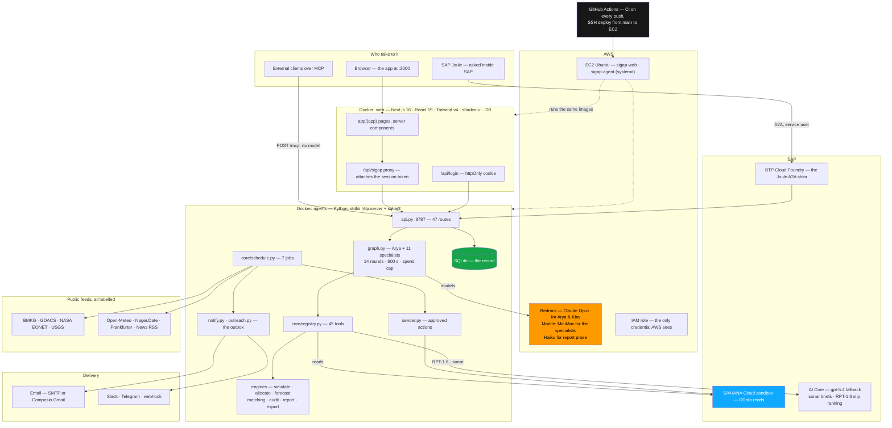
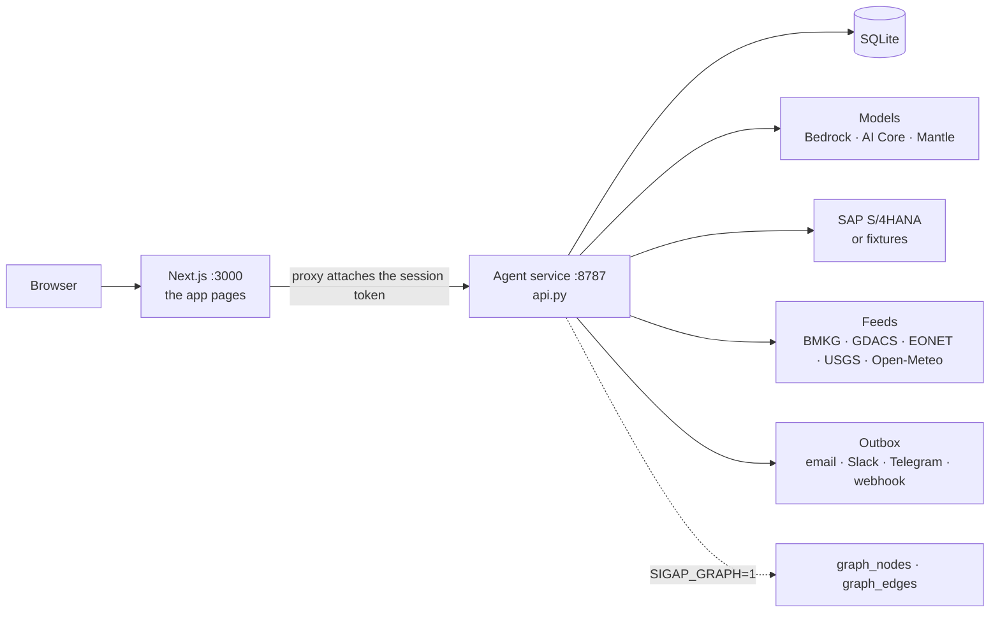
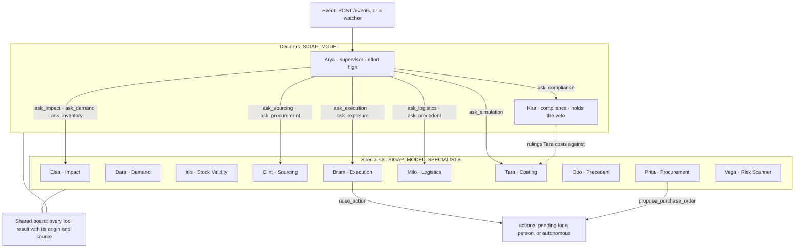
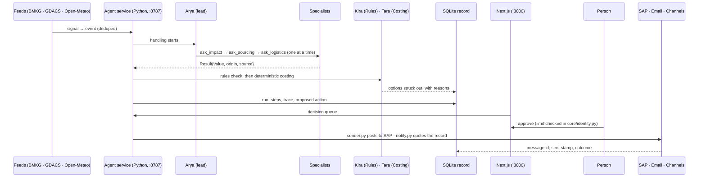
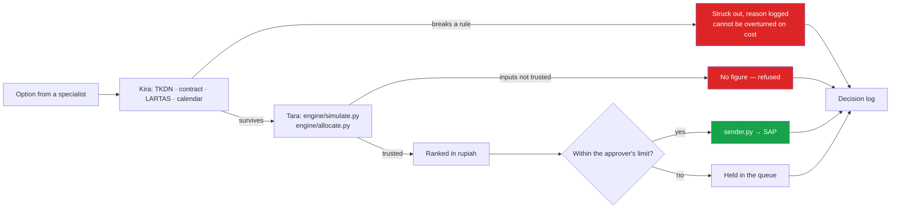
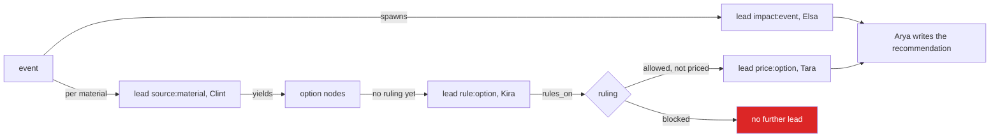

<p align="center">
  <picture>
    <source media="(prefers-color-scheme: dark)" srcset="public/logo/sigap-mark-19-dark.svg" />
    
  </picture>
</p>

<h1 align="center">SIGAP</h1>

<p align="center">
  <b>Supply Disruption Intelligence &amp; Anticipation System</b>
</p>

<p align="center">
  An autonomous assistant for manufacturers that import most of their raw material.
  When a port closes, a supplier misses a shipment or goods are held at customs, the system
  investigates the impact itself, assembles the ways out, strikes the ones that break Indonesian
  regulation or the customer contract, works out which is cheapest — and executes it into SAP
  only once someone with the authority approves.
</p>

<p align="center">
  <a href="https://sigap.lumbungstack.dev"></a>
  <a href="https://github.com/maulana-tech/socrates/actions/workflows/deploy.yml"></a>
  <a href="https://nextjs.org"></a>
  <a href="https://www.python.org"></a>
  <a href="https://aws.amazon.com/bedrock/"></a>
  <a href="https://www.sap.com"></a>
  <a href="#run-it"></a>
  <a href="LICENSE"></a>
</p>

---

A supervised swarm of **twelve agents**, a Next.js interface, and a deterministic calculator that
refuses to produce a rupiah figure it cannot stand behind. Two processes: the web app and the
agent service. No queue to babysit — the work starts from events.

> **The models propose; they never decide, and they never spend.**
>
> - Every tool return carries its origin — `live`, `cached`, `derived`, `modelled`, `missing`.
>   A failure produces `missing`, never a plausible-looking guess.
> - The calculator is pure Python with no model in it, and it **refuses** to emit a savings
>   figure when a critical input is not trustworthy.
> - Kira's rejection cannot be overturned on cost: an option that drops the local-content
>   ratio (TKDN) below the contract floor is struck out even when it is the cheapest of all.
> - Approvals are checked against the role's rupiah limit **server-side** (`core/identity.py`),
>   and nothing reaches a supplier, a customer or SAP except through a person's approval.

---

## Who this is for

Meet Budi, a supply chain manager at a manufacturer in West Java that imports most of its raw
material. A typhoon closes Ningbo for three days. He spends the next two to three working days
in email and spreadsheets: which orders does this actually hit, what stock is genuinely usable,
who else can supply it, does the substitution break the TKDN clause, what does each option cost,
and which purchase order does he raise first.

He has run this drill before and knows the answer will be wrong by Tuesday, because the data
moved. What he needs is not another dashboard. It is the analysis done, the rule check applied,
the cost worked out, and a recommendation waiting for his signature — with the evidence attached.

---

## The Problem

- **A disruption is a research project.** One event means tracing orders, stock, BOM and
  customs status by hand, across systems that were never designed to answer that question
- **The cheapest option is often forbidden.** TKDN floors, LARTAS licences and contract terms
  live in documents nobody reads while a spreadsheet is open
- **Cost models are trusted too much.** A single bad input turns into a confident rupiah figure
  that a director signs off on
- **"AI supply chain agents" guess.** They produce fluent summaries with no origin for any fact
  and no way to audit what they did
- **Nothing anticipates.** By the time the event is in the system, the shipment is already late

**How might we turn a disruption from a multi-day investigation into a tens-of-minutes
decision, without letting a model invent a number or break a rule?**

---

## The Solution

Five pieces, each doing a job the others cannot.

**1. Events, not logins.** Signal watchers poll BMKG (earthquakes), GDACS · NASA EONET · USGS
(hazards) and Open-Meteo (port weather), dedupe against the record and raise an event.
Vega's weekly scan finds the risk that has not happened yet: single sources, concentrated lanes,
certificates about to expire.

**2. A lead who calls specialists one at a time.** Arya pulls the agent the last finding calls
for — Impact, then Sourcing, then Logistics — deciding from evidence rather than a fixed
pipeline. There is no parallel guess-fest: the run is synchronous, ordered and fully recorded.

**3. Provenance on every fact.** Each tool returns `Result{value, origin, source}`. The board
refuses to let an untrusted fact back a rupiah figure, and the interface shows the label on
every number it prints.

**4. Rules before cost.** Kira tests every candidate against the rule pack — TKDN, contract
floor, LARTAS licensing, the holiday calendar — and marks which rules are verified and which
are assumptions. Only what survives reaches Tara's deterministic calculator.

**5. Execute, then explain.** Bram writes back to SAP within authority, drafts the customer and
supplier messages (both wait for a person to send), watches through to receipt, and records what
actually happened. Every approval, every send and every reason lands in the decision log.

---

## The Agent Council

Twelve agents, one lead. Each has its own page in the app (`/agents/:code`) and can be asked
anything directly from `/chat`.

| Agent | Code | Role | Tools | What it may do |
|---|---|---|---|---|
| **Arya** 👑 | `supervisor` | Team lead: pulls specialists as findings warrant, judges when evidence is enough, writes the recommendation with its trade-offs and residual risk | 1 | Nothing alone — every action waits for a person |
| **Elsa** | `impact` | Traces a disruption through orders, stock and the BOM to the customer commitments genuinely at risk | 4 | Read only |
| **Dara** | `demand` | The demand side: daily consumption as a variable that moves, not a fixed number | 3 | Read only |
| **Iris** | `inventory` | Which stock may actually be used — quality holds, rejected batches, safety floors | 3 | Read only |
| **Clint** | `sourcing` | Replacement supply: other suppliers, internal stock, fast freight, substitute materials with their approval status | 3 | Read only |
| **Prita** | `procurement` | The supplier book: volume, country, certificate, on-time record; quotations compared on price against lead time; drafts the purchase order | 6 | Read only (drafts wait for approval) |
| **Milo** | `logistics` | Arrival dates that survive contact with reality — measured customs dwell, port status, weather, news and holidays on the lane | 7 | Read only |
| **Kira** ⚖️ | `compliance` | Tests every candidate against TKDN, the contract floor, LARTAS licensing and the calendar; says which rules are verified | 2 | **Veto: a rejection here cannot be overturned on cost** |
| **Tara** | `simulation` | Costs the options that cleared the rules, and allocates short material across customer orders. Calls `engine/simulate.py` and `engine/allocate.py` | 2 | Deterministic engines, no model in the arithmetic |
| **Otto** | `precedent` | Institutional memory: what was done last time something like this happened, and how it turned out | 1 | Read only |
| **Bram** | `execution` | Writes back to SAP, tells the affected roles, drafts customer and supplier messages, records the outcome | 9 | Within its authority, and only after approval |
| **Vega** | `exposure` | Prevent mode: hunts risk that has not happened yet, ranked by what it would cost | 4 | Recommends; Bram raises it, a person approves |

Every agent's tools, parameters and prompts are **generated from the registry** into
[`sigap/AGENT-REFERENCE.md`](sigap/AGENT-REFERENCE.md) by `python3 manage.py docs`, so the
document cannot disagree with the code.

### Approval limits

Enforced server-side in `core/identity.py`, never in the UI:

| Role | May approve up to |
|---|---|
| `planner` | read only |
| `buyer` | Rp 500,000,000 |
| `procurement_lead` | Rp 10,000,000,000 |
| `admin` | Rp 10,000,000,000 |

Below `SIGAP_AUTONOMOUS_LIMIT_IDR` (default Rp 50 million) the system may act unattended; above
it, a person must sign. Model spend per event is capped by `SIGAP_COST_CAP_IDR`.

### The origin label every fact carries

| Label | Meaning |
|---|---|
| `live` | Read from the real source just now (SAP, an upload, an outside feed) |
| `cached` | From the record, still within its freshness window |
| `derived` | Computed from `live` inputs by deterministic code |
| `modelled` | From a fixture or a model's judgement — usable, never priced as fact |
| `missing` | The source did not answer. Never substituted with a guess |

---

## How one disruption runs

```
a signal arrives (BMKG · GDACS · Open-Meteo · POST /events)
  ├─ event recorded once, deduped against the record
  ├─ Arya: "what does this actually hit?"   → calls Impact
  ├─ that answer raises a new question      → Arya calls the next specialist
  │     one at a time, in the order the findings demand
  ├─ Kira: rules check → candidates that break TKDN, contract or licence are struck out
  │     (a strike here cannot be overturned on cost)
  ├─ Tara: deterministic costing of what survived → ranked in rupiah
  │     refuses outright if a critical input is not trustworthy
  ├─ Bram: the action written up, drafted emails attached, payload ready for SAP
  ├─ a person approves, within their role's limit (checked server-side)
  └─ delivery: sender.py → SAP   ·   notify.py → email, team channels, morning digest 07:30
        everything lands in the decision log with its trace
```

---

## Features

- **Decision queue**: every handling with what it proposes, what it would cost and what is
  waiting for a signature
- **Approval with authority limits**: role checked on the server, one-shot approvals,
  idempotent actions — approving twice cannot send twice
- **Dashboard**: the sharp end of the book — charts of exposure, orders at risk, what is
  blocked and why, with the full table one click away
- **Agent pages and chat**: ask any of the twelve directly, see its tools, prompts and past
  runs; conversations are kept per agent
- **Decision log and run trace**: every step of a run, every tool call with its origin label,
  the exploration graph of what was asked and what it found
- **Reports**: generated per handling or across the portfolio, exported to PDF and XLSX, and
  sent by email straight from the page
- **Schedule**: seven jobs that run without a person — three signal watchers, Vega's exposure
  scan, alert and outreach delivery, the SAP sender and the 07:30 digest; each toggleable and
  runnable by hand
- **Contacts and notifications**: who is told about what, by email or team channel, with a
  mailbox you connect and a test button; approved supplier and customer messages go out
  verbatim from the draft
- **Uploads**: bring your own data with downloadable templates; every read is labelled with
  where it came from
- **Data audit**: `engine/audit.py` reads whatever the system can see and reports what is
  wrong with it — deterministic, every finding carries its evidence
- **Models page**: list, test and switch the model behind each agent (`provider:model` on
  Bedrock, AI Core or Mantle), with a ping that proves it answers
- **MCP endpoint**: the agent service exposes `/mcp`, so external clients can call the same
  tools the swarm uses
- **SAP connector**: reads against the sandbox once `SAP_API_KEY` is set, writes through a
  CSRF-aware sender that only sends what a person approved
- **Auth**: session tokens signed by `SIGAP_SECRET`, identity from the token, `SIGAP_ENV=prod`
  refuses to start without SAP and a reachable lead model

---

## Tech Stack

| Layer | Technology |
|---|---|
| Web app | Next.js 16 (App Router), React 19, TypeScript, Tailwind CSS v4, shadcn-ui, D3 |
| Agent service | Python, stdlib `http.server` + `sqlite3`; `anthropic` only when Bedrock is configured |
| Models | Amazon Bedrock (Claude by default), SAP AI Core, Mantle — one model per agent, with a fallback |
| Persistence | SQLite (`data/sigap.db`): events, runs, steps, actions, approvals, contacts, outbox |
| Outside feeds | BMKG · GDACS · NASA EONET · USGS · Open-Meteo · holidays · FX · news, each labelled |
| ERP | SAP S/4HANA Cloud OData (sandbox by default, fixtures when the key is absent) |
| Interfaces | REST (47 routes, session required except `/health` and `/login`) · MCP (`/mcp`) |
| Delivery | Email (SMTP outbox with retries) and team channels, quoted from the record |
| Containers | Docker Compose: Next.js web, Python agent service, PostgreSQL |
| CI/CD | GitHub Actions: lint, agent output, Python self-check on every push; SSH deploy from `main` to EC2 |
| Tests | Python self-check, transport and rollback tests for the deploy scripts |

### The stack, drawn



Locally that is `docker compose up` (web container, agents container, Postgres). In
production the same two images run as `sigap-web.service` and `sigap-agent.service` on an
Ubuntu EC2 instance, deployed over SSH by GitHub Actions when a push to `main` passes CI —
[`ops/CICD.md`](ops/CICD.md) is the runbook, and the instance's IAM role is what lets the
agent service call Bedrock.

---

## Architecture

> The long form lives in [`sigap/architecture/`](sigap/architecture/) — one concern per
> file: [`app.md`](sigap/architecture/app.md), [`agents.md`](sigap/architecture/agents.md),
> [`tools.md`](sigap/architecture/tools.md), [`workers.md`](sigap/architecture/workers.md),
> [`data.md`](sigap/architecture/data.md). Paths below are relative to `sigap/agent/`
> unless they begin with `app/`, `components/` or `lib/`.

### System context

Two processes, one record.



| Process | Where | Job |
|---|---|---|
| Web app | `app/(app)/**`, `app/lib.ts`, `app/api/sigap/[...path]` | Server components read the agent service at render time; buttons POST through the proxy, which attaches the token. **The app holds no data and makes no decision** |
| Agent service | `sigap/agent/api.py` | Routes matched by regex from the `@route` table, one thread per request, runs the schedule, starts each handling on its own daemon thread |

Every route but `GET /health` and `POST /login` needs a bearer token. With `SIGAP_ENV=prod`
the service refuses to start without `SAP_API_KEY` and a lead model it can call, and
`POST /events` answers `503` while either is missing.

### The agent team



**Delegation has no fixed pipeline.** Each specialist is offered to the lead as one tool,
`ask_<code>`, described by its nickname, title and brief ("HAS VETO." for Kira). A
specialist sees only its own tools, so specialists cannot call one another — every hand-off
goes through the lead.

**The board is the evidence of one handling.** Every tool result is written under
`<agent>.<tool>` with its origin, source and fetch time, so no value can exist on the board
without saying where it came from. `Board.untrusted_keys()` — everything that is not
`live`, `cached` or `derived` — travels into the run's decision, the alert, the report and
Bram's autonomy check.

Inside the loop: at most **14 lead rounds**, **8 rounds per specialist**, **600 seconds** and
a spend cap (`SIGAP_COST_CAP_IDR`, default Rp 500,000). Progress is written as `steps` rows:
`DELEGATE`, `TOOL` (arguments, result, origin, source, milliseconds), `FINDING`, `SUMMARY`,
`FALLBACK`. One specialist failing does not end the handling — the lead is told to carry on
without it.

| How a handling ends | `decision.status` | Cause |
|---|---|---|
| The lead writes its answer | `done` | `end_turn` |
| A limit is hit | `partial` | spend over the cap, or 600 s elapsed — salvage lists what is on the board and writes no recommendation |
| Out of lead rounds | `stopped` | more than 14 rounds |
| Anything else raised | `failed` | the error is stored on the run |
| No model the lead can call | `held` | closed at once; nothing runs |

### Kira's veto, held in four places

1. **`tools/compliance.py`** — `check_local_constraints` rules one option at a time from
   the rule pack, the company profile and the holiday calendar, naming the rule and the
   numbers. The ruling is Python, whatever model Kira runs on
2. **`engine/simulate.py`** — costs only options that cleared. `allowed_options` can narrow
   the rulings, never widen them, and an option the rules struck out stays out even when a
   list names it. It also reports `compliance_cost`: what obeying the rules cost
3. **The prompts** — `supervisor.txt` never recommends an option Kira rejected,
   `execution.txt` never acts on one, not at a lower quantity, not partially
4. **The exploration graph** — Kira's ruling is a `ruling` node, and the planner
   (`engine/planner.py`) opens a price lead only for an option ruled `allowed`

### Models per agent

A model is named `provider:model`, resolved per call:

| Provider | Wire format | Where |
|---|---|---|
| `bedrock` | Anthropic Messages | Claude on Amazon Bedrock |
| `bedrock-openai` | OpenAI Chat Completions | other models on Bedrock (MiniMax, DeepSeek, Kimi, Qwen, GLM…) |
| `aicore` | Chat Completions | SAP AI Core, e.g. `gpt-5.4` |

Resolution order, most specific first — a choice saved on the **Models** page beats the
variable at the same level:

1. one agent — `<code>` / `SIGAP_MODEL_<CODE>`
2. the ten specialists — `specialists` / `SIGAP_MODEL_SPECIALISTS`
3. the lead and everyone else — `lead` / `SIGAP_MODEL` (default `anthropic.claude-opus-5`)
4. **fallback**, tried once when an agent's own model fails — `SIGAP_MODEL_FALLBACK`
5. **aux**, which writes report prose from figures it is handed and never a number

Arya and Kira skip level 2: the agent that decides what to do, and the one that decides what
may be done, stay on the strong model unless set one by one. `GET /models` lists every
agent's model and whether it answers.

### The autonomy limit

`SIGAP_AUTONOMOUS_LIMIT_IDR` (default Rp 50,000,000) is the ceiling for an action taken
without a person. `tools/execution.py autonomy_check` lets one go alone only when all four
hold: under the limit · raised inside a handling (there is a board) · nothing on the board
is `modelled` or `missing` · something was read before deciding.

Only `create_stock_transfer` asks that question. Every other change to the outside world —
`create_draft_po`, `propose_purchase_order`, `create_sourcing_event`,
`propose_safety_stock_change`, `draft_customer_notice`, `request_supplier_update` — is
recorded `pending` and waits for a person whatever its value.

### One handling, end to end



### How an option is judged



Every path ends in the decision log. There is no route to SAP or to an outside party that does
not pass through a person's approval first.

### The tools and the data path

`core/registry.py` holds one `Tool` per name: owner, description, JSON schema and the
function that runs. The schema the model sees is the schema that runs (`strict: true`,
`additionalProperties: false`), and **every tool returns a `Result`, never a bare value**.
An argument naming a material or a plant is checked before the tool runs — an id on record
passes, an ambiguous phrase raises back to the model rather than returning "nothing found".

Reads fall through three sources, and the label says which:

```
tools/fetcher.py   →  SAP OData (live)  →  an uploaded CSV (cached)  →  fixtures/ (modelled)
                                                                            a failed fetch → missing
```

| Agent | Tools | What it reads |
|---|---|---|
| Arya `supervisor` | 1 | the `events` table |
| Elsa `impact` | 4 | purchase orders, material stock, BOM explosion, sales-order commitments |
| Dara `demand` | 3 | production schedule, 90 days of goods issues → `engine/forecast.py` |
| Iris `inventory` | 3 | quality holds, safety-stock policy, open reservations → `engine/matching.py` |
| Clint `sourcing` | 3 | alternate sources, internal transfers, substitute materials |
| Prita `procurement` | 6 | supplier book, quotations, exchange rates (ECB), drafts a `draft_po` action |
| Milo `logistics` | 7 | shipment status, ETA from measured customs dwell, port weather, news, holidays, a cited web brief |
| Kira `compliance` | 2 | the rule pack, the company profile, the holiday calendar |
| Tara `simulation` | 2 | `engine/simulate.py`, `engine/allocate.py` — arithmetic with no model in it |
| Otto `precedent` | 1 | past incidents, their outcomes, what was done |
| Bram `execution` | 9 | raises actions, drafts outward messages, records outcomes, watches through to receipt |
| Vega `exposure` | 4 | single sources, concentrated lanes, certificate lapse, live hazards, PO slip (SAP RPT-1.6, labelled `modelled`) |

**The rule pack** (`sigap/references/`) is what Kira rules from: each rule carries its source
and whether it was verified. It is read by `tools/compliance.py` and shown by `get_rule_pack`.
The pack itself is knowledge work written per company, not code.

### Workers: what runs without a person

One Python process. `core/schedule.py` ticks every 15 seconds and starts whatever is due; a
job never overlaps itself, its next run is remembered in the `jobs` table, and a daily job
missed by more than two hours is skipped rather than delivered late.

| Job | Cadence | Effect |
|---|---|---|
| `bmkg` | 5 min | a quake of M5.0+ within 300 km of a facility becomes an event |
| `hazards` | 30 min | cyclone, flood, quake, eruption, fire or drought within radius of a plant or loading port |
| `weather` | 3 h | a forecast day over threshold at a port or plant (gusts 62 km/h, waves 4 m, rain 100 mm/day) |
| `exposure` | weekly | Vega's scan with **no model**: the top three findings by committed value |
| `notify` | 30 s | delivers the outbox — alerts, digests, reports, outreach |
| `sap_send` | 10 min | approved actions posted to SAP, retried until they land |
| `digest` | daily 07:30 WIB | the morning summary to every contact who chose it, and the team channels |

Every watcher dedupes against the record (`store.event_exists`) and raises the event through
the same call a person's `POST /events` makes, so a restart never replays a feed. Every
outside GET goes through `clients/feeds.py`: a cache that keeps the real fetch time, a
timeout, and a short memory of a failure — a feed that is down costs one timeout and becomes
`missing`, never a quiet day.

**Approve, then send.** An action is a row in `actions`, and its status only moves forward:

```
tool raises it → pending (decision queue) → approved (role limit checked server-side)
                → sender.py → SAP, with an Idempotency-Key
                → or outreach → the outbox → email, as written, never composed here
                → outcome recorded once
```

A failed write keeps the status and is retried next pass; a decided action cannot be decided
again; a rejection releases the stock the action was holding in the same transaction. Outreach
needs a buyer above for a supplier request and a procurement lead above for a customer notice,
on top of the money limit — and outside `prod` nothing reaches a real partner, it goes to
`SIGAP_EXTERNAL_REDIRECT` marked `[TEST]`.

**Channels**: SMTP, Composio Gmail, Slack, Telegram or a webhook. A channel that is not set
up marks its messages `skipped` with what it lacks rather than holding them; a failure is
retried three times, then `failed`.

### The record, and what comes out

One SQLite file (`SIGAP_DB`, default `data/sigap.db`). What lands there is the official
record: what was decided, on what evidence, who approved it and what was actually sent.
`approvals` rows are never changed; an `actions` row moves one way; a correction is a new row.

| Group | Tables |
|---|---|
| The handling | `events` · `runs` · `steps` · `actions` · `approvals` · `reservations` |
| Exploration | `graph_nodes` · `graph_edges` (with `SIGAP_GRAPH=1`) |
| People and settings | `users` · `conversations` · `messages` · `contacts` · `uploads` · `settings` · `jobs` |
| Delivery | `notifications` — one message to one address over one channel, with its status and attempts |

Everything the system produces is built from that record:

- **Reports** — per handling or across the whole portfolio, markdown, PDF and XLSX, written
  with the Python standard library (`engine/report.py`, `engine/export.py`). The only text a
  model writes is the optional executive summary, handed the figures and told not to
  introduce a number
- **The trace** — `core/topology.py` folds the steps into a graph of event → agent → tool →
  source → action, each edge carrying its calls, step numbers and weakest origin; drawn on
  `/log/[id]`
- **The exploration graph** — the same handling as a DAG, served by `GET /runs/{id}/graph`
  and drawn on `/disruptions/[id]`
- **Alerts** — the message as sent: status, the lead's recommendation quoted and labelled,
  what waits for approval with the lowest role that may approve it, and a warning when
  evidence was modelled or missing
- **SAP writes** — each carrying the action's idempotency key, storing the reference SAP
  returns
- **[`sigap/AGENT-REFERENCE.md`](sigap/AGENT-REFERENCE.md)** — regenerated from the live
  registry by `python3 manage.py docs`, so it cannot disagree with the code

### The pages

| URL | Shows |
|---|---|
| `/` | the decision queue: every handling, what it proposes, what it costs, what waits for a signature |
| `/dashboard` | exposure, orders at risk, what is blocked and why |
| `/disruptions/[id]` | one handling: recommendation, actions, approvals, the exploration graph |
| `/log`, `/log/[id]` | every run, and one run's trace — each tool call with its origin |
| `/reports`, `/reports/[id]`, `/reports/portfolio` | reports and the portfolio, as PDF/XLSX or emailed from the page |
| `/agents`, `/agents/[code]`, `/chat` | the twelve, their tools, their data, and a conversation with any of them |
| `/audit` | what is wrong with the data the system can see, with its evidence |
| `/uploads` | bring your own data, with downloadable templates |
| `/contacts`, `/notifications` | who is told about what, and by which channel |
| `/models` | the model behind each agent, testable from the page |
| `/schedule` | the seven jobs: on/off, last result, run now |

A page whose handling is running refreshes every four seconds while the tab is visible, so
the queue, a disruption and its trace follow the agents without a reload.

### The other ways an agent runs

| Entry | What runs | Records |
|---|---|---|
| `POST /agents/{code}/ask` (the conversation page) | one specialist's tool loop on your question, with chat history and attachments | conversations and messages; an action raised from a question comes back `missing` — actions come from a signal |
| `POST /mcp` | the same registry tools, called directly, **no model** | only what the tool itself writes |
| `GET /exposure`, the `exposure` job | Vega's scan through the registry, **no model** | the top three become events |
| `python3 main.py` | a scripted walk of the design scenario, **no model**, real calculator | a JSON trace only |
| `python3 graph.py` | the orchestration's self-check on a stand-in model and a scratch database | nothing in the real record |

Two flags, both off by default, change how a handling runs:

| Flag | Turns on |
|---|---|
| `SIGAP_GRAPH=1` | the exploration graph: board writes mirrored as `fact` nodes, Clint's options as `option`, Kira's rulings as `ruling`, and the deterministic planner opening the next leads. Fail-open: a graph error never touches the handling |
| `SIGAP_SWARM_ASYNC=1` | `engine/dispatch.py`: several specialists at once over a claimable frontier on `SIGAP_ASYNC_WORKERS` threads (default 4), with `core/admission.py` bounding work per operator and globally. Arya writes the recommendation once, from the settled graph |

The planner is deterministic because the mitigation chain is known:



---

## Run it

### Option A: Docker Compose (recommended)

Runs all three containers — **Next.js web**, **Python agent service** and **PostgreSQL** —
with one command.

```bash
# 1. prepare the environment file
cp sigap/agent/.env.example sigap/agent/.env     # see sigap/ENV.md for every line

# 2. build and start
docker compose up -d --build

# 3. watch it
docker compose ps
docker compose logs -f agents

# 4. open it
#    web   → http://localhost:3000
#    agent → http://localhost:8787
#    db    → localhost:5432
docker compose down          # stop
docker compose down -v       # stop and wipe the database volumes
```

### Option B: Manual (two processes)

```bash
# the agent service
cd sigap/agent
python3 manage.py secret                  # export its output as SIGAP_SECRET
python3 manage.py user you@example.com "Your Name" buyer yourpassword
python3 manage.py seed                    # optional demo data
python3 api.py                            # :8787

# the interface, in another terminal
npm install
SIGAP_API=http://127.0.0.1:8787 npm run dev
open http://localhost:3000/dashboard
```

Nothing else needs starting: `api.py` runs the schedule, which watches the feeds, delivers
alerts and pushes approved actions to SAP.

To see what is and is not wired up:

```bash
cd sigap/agent && PYTHONPATH=. python3 manage.py check
```

With no accounts anywhere, the four-line fast path in [`sigap/ENV.md`](sigap/ENV.md) brings
the whole system up on fixtures. Everything from a fixture is labelled `modelled`, so the
calculator will not price it — production refuses to run without real SAP and a real model.

---

## Documentation

Everything lives in [`sigap/`](sigap/):

| File | What's in it |
|---|---|
| [`sigap/PLAN.md`](sigap/PLAN.md) ⭐ | The plan, the status of each part, what to do next |
| [`sigap/AGENT-REFERENCE.md`](sigap/AGENT-REFERENCE.md) | All 12 agents and their 45 tools, **generated** from the registry |
| [`sigap/architecture/`](sigap/architecture/) | How the parts fit together: app, agents, tools, workers, data |
| [`sigap/ENV.md`](sigap/ENV.md) | Every environment variable, where to get it, how to check it works |
| [`sigap/SETUP.md`](sigap/SETUP.md) | The ordered walkthrough for a first-time setup |
| [`sigap/DESIGN.md`](sigap/DESIGN.md) | The scenario and its figures, the constraint rules, the eval suite |
| [`sigap/TECHNICAL.md`](sigap/TECHNICAL.md) | Model calling conventions, caching, limits |
| [`sigap/DATA-SOURCES.md`](sigap/DATA-SOURCES.md) | What was verified about each data source |
| [`sigap/SWARM-COMPARISON.md`](sigap/SWARM-COMPARISON.md) | SmartX ↔ SIGAP: what a swarm architecture can teach this one |
| [`sigap/AWS-PLAN.md`](sigap/AWS-PLAN.md) | Getting onto Bedrock and AgentCore, in the order that works |
| [`sigap/agent/README.md`](sigap/agent/README.md) | Running the agent service, configuration, the API |
| [`ops/CICD.md`](ops/CICD.md) | GitHub Actions: CI on all branches, SSH deployment from main to EC2 |

---

## Status

`PYTHONPATH=. python3 manage.py check` prints this live, from the code rather than from a table.

**Working**: provenance labelling on every tool, the deterministic calculator, SAP reads,
persistence with idempotent actions and one-shot approvals, auth with server-side authority
limits, the full interface, all 45 tools, all 12 prompts, the signal watchers (BMKG, hazards,
weather), the schedule, email and outreach delivery, reports by email, the data audit, and the
agent team running end to end on AI Core.

**Held back honestly**: the SAP write path is complete but untested against real entities; the
rule pack (`sigap/references/`) is read but not written — that is knowledge work, not code;
`AWS_REGION` unset means the team has not run against Bedrock yet, and until a model is
reachable the system makes no decisions at all rather than pretending to.

[`sigap/PLAN.md`](sigap/PLAN.md) §2 has the detail, and what is blocking each item.

---

## License

MIT — see [`LICENSE`](LICENSE).
