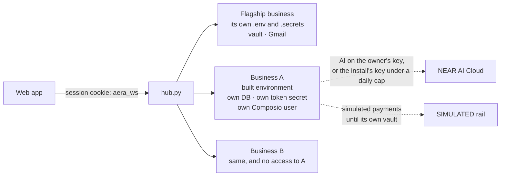
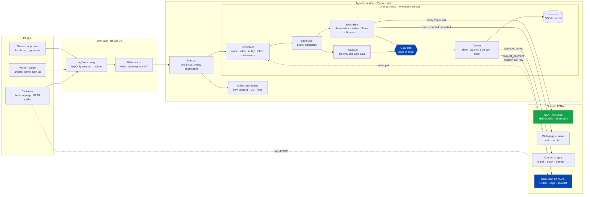
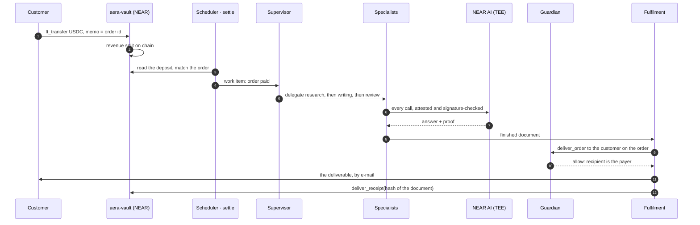
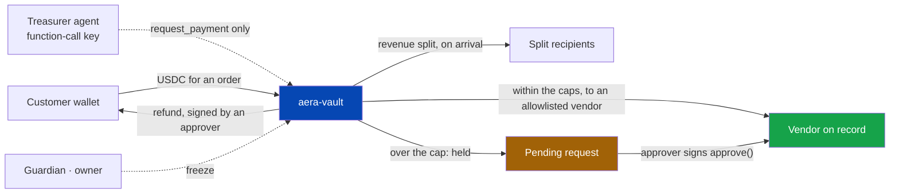

<p align="center">
  <picture>
    <source media="(prefers-color-scheme: dark)" srcset="public/logo/aera-mark-19-dark.svg" />
    
  </picture>
</p>

<h1 align="center">AERA</h1>

<p align="center"><b>Autonomous Enterprise, Run by Agents</b></p>

<p align="center"><b>Live:</b> <a href="https://aera.utdi.me">aera.utdi.me</a> — <b>create your own business</b> (its own team of agents, on your NEAR AI key or ours), try the demo business as a tester, or read everything with <i>Use the demo account</i></p>

<p align="center">
  Describe a business. AERA composes the team of AI agents that runs it — they take the order,
  do the work, get paid and pay their own costs — thinking inside attested TEEs on NEAR AI, and
  moving money only through a NEAR vault whose rules a person set on chain.
</p>

<p align="center">
  
  
  
  
  
  <a href="LICENSE"></a>
</p>

---

## Hackathon tracks

AERA is entered in **three tracks** of NEAR Hackathon 2026. One running product serves all three: the same
business that runs itself (track 1) does it on private, attested models (track 2) behind brakes a prompt cannot
talk past (track 3).

| Track | What AERA brings to it | See it |
|---|---|---|
| **Autonomous Business** | Describe a business and a team of agents runs it end to end: finds customers, sells at a checkout, does the work, delivers it, gets paid in USDC into an on-chain vault, pays its own vendors, buys from other agent businesses and keeps the books. A scheduler hands it work every 20 seconds; how much ran with no person is counted in code. Anyone can create their own business on the live install, and its agents can work in 1,700+ apps (Slack, Sheets, Notion, HubSpot…) connected through Composio. | [aera.utdi.me](https://aera.utdi.me) → *Create your business* · Dashboard → Autonomy & Your AI team · `/leads` · Settings → Connect tools · Treasury |
| **Privacy & Private AI** | Every agent thinks on a NEAR AI Cloud model inside a TEE; each call's attestation (fresh nonce) and response signature are verified and shown on the run. Private mode refuses unattested models. Personal data is redacted before alerts leave, and each business created on the install runs in its own process with its own database, keys and Composio user. The Trust Center lists **everyone outside AERA that data can reach** (models, mail, alert channels, every connected app) and the data register counts what is held, prospects and opt-outs included. | A run page → *Verified* panel · Trust Center → *Where your data can go* · `core/attest.py` · `core/compliance.py` · `hub.py` |
| **AI Security & Defense** | Three brakes on every payment: tools take record ids not addresses, the Guardian's rules run in code before any action, and the vault enforces its caps on chain with the agent holding only a function-call key. Outside text never gives orders; opt-outs are forever; a tester's work can never pay on its own say-so. Tools from outside apps (Composio, MCP) go only to the agents a person chose; reads are labelled outside text, and every write is an action the Guardian checks (arguments read for injection, personal data named) and a person approves. | Landing → *Try to fool the Guardian* · `manage.py attack-demo` · `core/guardian.py` · `aera/contracts/aera-vault` |

Details for each track: [The three tracks, concretely](#the-three-tracks-concretely).

> **Humans set the constraints. Agents do the work. Code — and the chain — enforce the rules.**
>
> - The team is **composed from the business a person describes**, not hard-coded: a research shop
>   gets a researcher, writer and reviewer; a brand studio gets a designer; a custom role is a draft
>   until a person approves it.
> - Every agent thinks on a **TEE-attested model** (NEAR AI Cloud), and every model call carries a
>   proof — attestation with a fresh nonce plus a signature over the exact request and response —
>   that the Verified panel shows and re-checks live.
> - Money moves only through **aera-vault**. The agent holds a **function-call key** that cannot
>   attach a deposit, so it cannot move a token except through the vault's allowlist and caps.
>   Over the limit, a person signs from their wallet. Anyone with authority can freeze it.
> - A prompt-injected agent is stopped three times: the tools take ids not addresses, the guardian's
>   rules run in code before any action, and the vault refuses on chain.

## The journey, as a user sees it

| | Where | What happens |
|---|---|---|
| 0 | **Landing** (`/`) | What AERA is, with live figures from the public ledger, an interactive Guardian you can try to fool, a team composer and the testnet transactions. |
| 1 | **Create your business** (`/login?mode=business`) | Anyone: business name, your name, email, password, and the AI it runs on — **AERA's key** (free, a daily allowance) or **your own NEAR AI key** ([how to get one](https://aera.utdi.me/guide/near-ai-key)). The business gets its own agent service, database and team, and you land on onboarding to describe it. Payments run simulated until you connect your own NEAR vault. |
| 1b | **Try the demo** (`/login?mode=tester`) | A *tester* account on the demo business: give its team work and talk to any agent within a daily allowance; it approves nothing, and anything its work would pay or send waits for the owner. |
| 1c | **First run** (`/login`) | No account yet → *Set up AERA* creates the owner. Owners add approvers and operators under **Settings → Accounts**. With `AERA_DEMO_EMAIL`/`AERA_DEMO_PASSWORD` set, **Use the demo account** fills in a read-only viewer sign-in (it approves nothing and changes no settings). Anyone can also **create an account** (a *tester*): give the team work and talk to any agent within a daily allowance; it approves nothing, and anything its work would pay or send waits for the owner (`AERA_SIGNUP=0` closes it). |
| 2 | **Onboarding** (`/onboarding`) | Five explained steps: *Describe* (or **Draft with AI** from a paragraph, on a TEE model) → *Offerings* → *Limits & rules* → *Team* → *Review* in plain sentences. Nothing is saved until the end; a refresh keeps the draft. |
| 3 | **Dashboard & Chat** | A *Getting started* checklist (models, vault, approver, first order), money in and out, what waits for you, what the Guardian blocked, TEE proofs, and the team visibly at work. **Chat** asks the team, or one agent, in plain words; a request becomes a work item. |
| 4 | **Orders** | Share the checkout link for each offering (`/buy/<id>`). A customer pays USDC from their wallet to the vault; the vault splits revenue on the spot. |
| 5 | **Work** | Each paid order (or request, or standing goal) is a work item. The run page shows the Supervisor's delegation, every tool call with the origin of its data, the documents produced (download the PDF), the Guardian's rulings rule by rule, and the **Verified** panel of TEE proofs. |
| 6 | **Approvals** | Anything above the limits waits on the run page and in **Treasury**. Approval limits come from your role: operator $100, approver $1,000, owner more. Over the vault's own cap, an approver signs in their NEAR wallet. |
| 7 | **Treasury, Books & Ledger** | Vault balance and policy, payments with their transactions, held payments and refunds to sign, a warning when the vault's limits differ from the profile. Books, receipts and the monthly report are computed in code and reconciled against the vault. The ledger is public (`/ledger-public`) and carries no customer data. |
| 8 | **Leads** (`/leads`) | Set the ideal customer in **Business → Finding customers** and the team gains a Lead Researcher and Sales. Leads are found on the open web, each saved with the public page that shows its address; the first message to each waits for your approval; follow-ups go out on schedule only while nobody has answered; replies come back over IMAP (or a forwarding webhook, or pasted by hand) and become work; a request to stop is final. The funnel (found → written to → answered → won) and the AI cost per lead are counted in code. |
| 9 | **Autonomy** (Dashboard) | Counted in code: how much finished work needed no person, every time a person stepped in and why, margin per order, the floor price of each offering, what the free samples brought. |
| 10 | **Trust Center** (`/trust`) | The evidence on one page: TEE proofs per model, what the Guardian stopped, personal data held (counted from the tables), which policy pages exist or are drafts, systems health. |
| 11 | **Kill switch** | Approvers and owners can stop everything at once (and freeze the vault); only an owner resumes. |

Without a NEAR AI key, work is recorded and **held** (a banner says why; *Run again* once the key is set).
Without a vault, payments run on the **SIMULATED** rail, labelled on every page. Nothing pretends.

## The team

The Composer (`aera/agent/core/team.py`) builds the team from the profile — the same profile always
yields the same team. Agents are named by role.

| Role | Always? | What it may do |
|---|---|---|
| **Supervisor** | yes | Reads the work item, delegates one step at a time, writes the outcome. Cannot move money. |
| **Guardian** | yes | Rules on every payment, refund, message and counterparty; its block is final; can freeze. |
| **Treasurer** | yes | The only agent that can pay: vendors on record, through the vault, within limits. Quotes cross-chain payouts (NEAR Intents). |
| Researcher · Writer · Analyst · Quality Review | from the offerings | Research the open web (as untrusted data), write and review deliverables. |
| Sales · Customer Support · Marketing | from the channels and goals | Answer and draft messages; the Guardian checks each before it goes. Sales writes to leads, follows up and answers replies. Marketing publishes free samples to `/samples` once the code checks pass. |
| **Lead Researcher** | when the profile names an ideal customer | Searches the web and the news for businesses that fit and saves them as leads, only with an address the page itself shows. Writes to nobody. |
| Fulfilment · Procurement · Designer | from the offerings and limits | Deliver orders to the paying customer; find vendors (and read the catalogue of a vendor that runs its own AERA); design briefs. |
| **Finance** | when there are offerings | Books, receipts, monthly report and reconciliation: every figure computed in code, the agent adds commentary only. |
| **Legal & Compliance** | when client material is held | Checks text before it goes out (forbidden promises, other people's data, advice that sounds final), tracks Terms/Privacy/Refund pages, files the record of personal data. Drafts only; "not legal advice". |
| **Tech Lead (CTO)** | from the role library | Reads runs, fallbacks, failing tools, attestation, AI spend and the vault; recommends changes and where the owner makes them. Changes nothing itself. |
| *custom* | your words | A draft with basic capabilities until a person activates it. Never money, never veto. |

Any library role can also be added by hand on **Team → Add from the role library**; it stays through a recompose.

## One install, many businesses

`hub.py` is what the container runs. It starts the flagship business (`api.py`, as before) and every business
people create on the install, each as **its own agent service**: its own process, SQLite database, team,
scheduler and session-token secret.

- **Isolated by construction.** A created business is started with an environment the hub builds and
  `AERA_NO_ENV_FILES=1`, so it never reads the install's `.env` or `.secrets`: it holds no vault key, no NEAR
  account and no mail settings of the flagship's. Its payments run on the SIMULATED rail until its owner connects
  a vault of their own. A session token from one business is worthless at another.
- **Whose AI.** The owner's own NEAR AI key when they give one (at sign-up or later under **Models → NEAR AI
  key**), with no allowance from AERA; otherwise the install's key under a hard daily cap the owner cannot
  raise (`AERA_HUB_SHARED_DAILY_USD`, $0.50 by default). The guide at `/guide/near-ai-key` walks through getting
  a key from NEAR AI Cloud.
- **Capped.** New businesses per day and in all (`AERA_HUB_NEW_PER_DAY`, `AERA_HUB_MAX_TENANTS`); the hub's own
  API answers only the web server (`AERA_HUB_SECRET`), inside the container network.
- **Found at sign-in.** The web app asks the hub which businesses an email belongs to and signs the person in to
  theirs; public pages of a created business carry `?b=<slug>` (checkout, samples, ledger).



Capabilities, not tools, are granted; `treasury`, `guardian` and `supervisor` are locked to their
owner in code and re-checked on every call.

## Architecture

One web app, one agent container, and the chain. Every business is its own agent service; inside one, work
flows from the scheduler to the Supervisor and its specialists, and **everything that leaves the business goes
through the Guardian first**, then through the vault's own rules if it is money. Deeper detail, file by file:
[`aera/ARCHITECTURE.md`](aera/ARCHITECTURE.md) · every NEAR call: [`aera/NEAR.md`](aera/NEAR.md).

### The system



Green is private (models in TEEs); blue is where a rule holds whatever an agent believes: the Guardian in code,
the vault on chain. Dotted lines are the chain talking to AERA, not AERA deciding.

### An order, end to end



### Where the money can go



The agent's key is a **function-call key**: it can ask the vault for a payment and nothing else, so a vendor the
vault has not allowlisted, an amount past its caps, or a refund are refused on chain whatever the agent was told.
There is no path from an agent to a plain transfer.

### One action, end to end

```
agent (on a NEAR AI model, in a TEE)
  ├─ calls a tool by record id: pay_vendor(contact_id, …), never an address the model wrote
  ├─ the tool reads the payout account from the contact record, not from the prompt
  ▼
guardian.check_action(kind, payload)   + check_counterparty() for money       core/guardian.py
  │   kill switch · injection phrases · forbidden claims · caps per payment and per day
  │   blocklist · address changed < 14 days · account age · vault allowlist
  │   opt-outs · daily outreach cap · personal data in outside writes · untrusted input in the run
  ▼
raise_action()  under an idempotency key: a retry is never a second payment       core/actions.py
  │     block  → recorded as blocked. Final.
  │     warn   → waits for a person; how much they may approve comes from their role
  │     allow  → carried out now, on the team's authority
  ▼
settle.execute()  re-reads the action under a lock: one executor, still approved   settle.py
  ├─ payment       → vault.request_payment with the function-call key
  │                    over the vault's cap: held on chain until an approver signs approve()
  ├─ message       → the outbox; outside production only to a test address          notify.py
  ├─ outside write → Composio / MCP, only if a person still allows that tool        settle.py
  ▼
on the record: the run, every tool call and its origin, the Guardian's reasons, who approved, the tx hash
```

### The shape of the code

```
aera/agent/            the agent service, Python standard library only
  api.py               HTTP API and the scheduler's home
  hub.py               one install, many businesses: each its own isolated service
  graph.py             Supervisor → specialists, bounded tool loops, salvage
  core/                guardian, actions, business profile, team composer, prospects, peers,
                       economics, compliance, privacy, attest (TEE proofs), chain (NEAR), store (SQLite)
  tools/               what agents may do, by capability: research, documents, money, prospecting, …
  clients/             NEAR RPC, NEAR Intents, web data, Composio, mail, inbox
  agents/              role library and capability locks
  settle.py · notify.py · jobs.py   carrying out approved actions, the outbox, the schedule
aera/contracts/aera-vault/   Rust vault: caps, allowlist, approvers, revenue split, freeze
app/ · components/ · lib/    Next.js 16: dashboard, landing, checkout, Trust Center, Apps
deploy/                      Caddy · Cloudflare Tunnel · Tailscale · backups
```

## The three tracks, concretely

| Track | What to look at |
|---|---|
| **Autonomous Business** | Profile → Composer → team (`core/business.py`, `core/team.py`, `graph.py`); orders in and payments out (`settle.py`, vault `ft_on_transfer` with on-chain revenue split); public checkout `/buy/[offering]` where Sales answers visitors; the team buys its own inputs within limits and quotes cross-chain payouts via NEAR Intents 1Click; books and reconciliation in code (`core/finance.py`); autonomy and unit economics counted in code (`core/economics.py`); Marketing publishes free samples whose checkout links count the orders they bring; **the team finds its own customers** (`core/prospects.py`, `tools/prospecting.py`): leads from public pages, first message approved by a person, follow-ups on schedule, replies read from the inbox and handed back as work, a paid order from the lead's address marks it won; **businesses run by agents buy from each other** (`core/peers.py`): order at another AERA's checkout, pay from the vault to the payout on record, the seller confirms from the sender's vault record, the deliverable comes back as outside text; public ledger. |
| **Privacy & Private AI** | Every agent on a NEAR AI Cloud TEE model; `AERA_PRIVATE=1` refuses non-attested ones (`core/llm.py`). Each call's attestation (fresh nonce) and response signature are verified (`core/attest.py`) and shown in the Verified panel, re-checkable live. Prompts kept in memory only; PII redacted by NEAR AI's privacy filter before alerts reach Slack/Telegram (`core/privacy.py`); outward mail never contains another customer's data; Legal & Compliance keeps a record of the personal data held, counted from the tables (`core/compliance.py`). |
| **AI Security & Defense** | Three brakes: tools take ids not addresses; Guardian rules in code before any action (`core/guardian.py`: injection, blocklist, address-change cooldown, caps, privacy); the vault on chain (`aera/contracts/aera-vault`) with an agent that holds only a function-call key. `manage.py attack-demo` runs one injected payout request against every brake → `aera/demo/attack-log.md`. A run that read outside text (web, news, outside servers) cannot pay, refund or write out without a person; writes to outside MCP servers are allowed per server only. Prospecting cannot spam: an address no page shows is refused, cold messages are capped per day, follow-ups never come early or past the limit, a reply's words reach the team only through a tool that marks the run as having read outside text, and an opt-out is enforced by the Guardian forever. |

## Run it

```bash
cd aera/agent
PYTHONPATH=. python3 manage.py check                       # 59 offline self-checks
cp .env.example .env && PYTHONPATH=. python3 manage.py secret   # → AERA_SECRET in .env
PYTHONPATH=. python3 api.py                                # :8787

# repo root, another terminal
cp .env.example .env.local && npm install && npm run dev   # :3000 → set up the owner in the browser
```

Forgot a password? `python3 manage.py password <email>` (hidden prompt), or add `--generate` in a
shell with no terminal: a random one goes to the clipboard, never to the screen.

Want content straight away? `PYTHONPATH=. python3 manage.py demo` seeds the example business
(Lumen Research, a market-research shop) and its team before you open the browser.

Then, to make it real ([`aera/SETUP.md`](aera/SETUP.md)):

1. **Models** — put `NEARAI_API_KEY` in `aera/agent/.secrets/near.env`; `python3 scripts/near_spike.py`
   checks tool calling and attestation on each candidate model.
2. **Vault** — `cd aera/contracts/aera-vault && cargo test && cargo near build non-reproducible-wasm`,
   then `python3 manage.py near-setup` prints every testnet command; `manage.py ready` confirms the
   agent holds no full-access key.

`docker compose up` runs both services (the agent container runs `hub.py`). Deploying to a server, with HTTPS
through Caddy, Cloudflare Tunnel or Tailscale: [`deploy/README.md`](deploy/README.md). Set `AERA_HUB_SECRET` in the
root `.env` to let people create their own businesses.

## Try it in five minutes

1. Open the app → create the owner → pick a template (or *Use the example business*) → *Next* through the steps → *Save*.
   On a prepared install, **Use the demo account** on the sign-in page looks around read-only instead.
2. **Team**: see who the Composer picked and why; open the Guardian's card — note its locked capabilities.
3. **Orders → Share checkout links** → open `/buy/brief` in a private window, fill it in, pay
   (or, without a vault, back in Orders: *Mark paid (simulated)*).
4. **Work**: the order is a work item; open the run (with a model key: watch the team work; without:
   it is held and says why).
5. **Trust Center**: the proofs, the personal-data record, and systems health in one place.
6. `cd aera/agent && PYTHONPATH=. python3 manage.py attack-demo` — then read `aera/demo/attack-log.md`.

## What is verified, and what is not yet

| | Status |
|---|---|
| Agent service | 59 offline self-checks (`manage.py check`) |
| Creating a business | End to end in a browser against a local hub: create → own service on the shared key with its cap → onboarding → sign out and back in to the same business → own key from Models lifts the cap; the created service's environment holds no vault key, NEAR account or hub secret (inspected) |
| Sign-up, landing | Tester sign-up and its refusals (approve, settings, kill switch) in a browser; landing interactions (Guardian playground, composer, approval, FAQ, phone menu) on the live site |
| Live deploy | [aera.utdi.me](https://aera.utdi.me): Docker Compose on one server behind a Cloudflare Tunnel |
| Vault contract | 47 unit tests (`cargo test`); sandbox integration test written, run with `--features sandbox -- --ignored` |
| Web app | `npm run lint`, `npm run build`, `npm test` |
| Live NEAR AI attestation | Report fetched and checked with a fresh nonce (nonce binding, compose hash, signing key, model verifiable; GPU via NVIDIA NRAS optional) |
| Live NEAR Intents | Dry 1Click quotes |
| Live on testnet (`vault.lanadev.testnet`) | A customer order paid 15 USDC into the vault ([`Dj6GRKMA…`](https://testnet.nearblocks.io/txns/Dj6GRKMAmCSjGdiwgoREoWKkpzcL7YRu9VdW4c3VytHa)), worked by the team on NEAR AI and delivered. The team bought a $3 dataset on its own, under the cap ([`E7B2f1UB…`](https://testnet.nearblocks.io/txns/E7B2f1UBpSSiArEyLvDZnm8jEa7L7bvs82q4TVEtTFKk)). An $8 purchase went over the cap: approved in AERA, held by the vault, paid only after the owner signed `approve` ([`31BQURup…`](https://testnet.nearblocks.io/txns/31BQURupVH6h8NVuxw5ThpLhi7wQn5t57uVQvX7pwsPg)). The attack demo was stopped by all three brakes on chain. |
| Not yet run live | wallet signing from the browser (the owner signed with near-cli); prospecting end to end with real mail (built and checked offline; needs a search key, SMTP and an inbox) |

## Layout

| Path | |
|---|---|
| `aera/agent/` | Python service, standard library only: API, agents, tools, schedule, NEAR clients, crypto |
| `aera/contracts/aera-vault/` | Rust vault contract (near-sdk) with unit and sandbox tests |
| `aera/agent/hub.py` | One install, many businesses: starts each as its own isolated agent service |
| `app/`, `components/`, `lib/` | Next.js 16 web app (`components/landing/` is the landing page, `lib/tenant.ts` routes a request to its business) |
| `deploy/` | Server deploy: Caddy, Cloudflare Tunnel, Tailscale, database backup |
| `aera/ARCHITECTURE.md` · `aera/NEAR.md` | How it fits together; every NEAR call |

## Built at NEAR Hackathon

All NEAR work and the new product were written during the hackathon window, on top of an earlier
multi-agent engine (built for a different hackathon, as a supply-chain assistant) whose domain was
removed entirely.

- Baseline before the hackathon: tag **`pre-hackathon`**. Submission: tag **`hackathon-submission`**.
- Diff: `git diff pre-hackathon..hackathon-submission` (on GitHub: `compare/pre-hackathon...hackathon-submission`).
- **Kept from the engine** (generalised): the tool-loop orchestration and its bounds, the tool
  registry, provenance labels, the SQLite record, approvals by role, the scheduler, the MCP server
  and client, skills, the outbox and channels, the PDF/XLSX writer, the web shell.
- **New**: business profile and Composer, dynamic roster, capability lock, guardian rules, actions
  and settlement, NEAR AI provider and TEE attestation, pure-Python Ed25519/Borsh/Keccak/secp256k1,
  NEAR RPC + transactions, 1Click client, the vault contract, orders and checkout, treasury, ledger,
  attack demo, prospecting (leads, outreach, follow-ups, inbox), free samples, businesses buying from
  each other, the autonomy report, sign-up and tester accounts, the multi-business hub, the landing page,
  the new web pages.
- **Libraries**: none in the agent service; the vault uses `near-sdk`; the web app's are in `package.json`.
- **AI-generated code**: much of this repository was written with Claude Code (Anthropic), reviewed
  and tested by the team.

## License

MIT — see [`LICENSE`](LICENSE).
