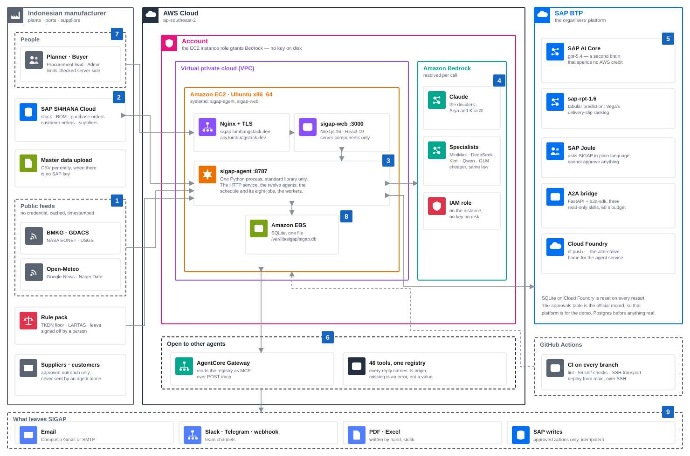
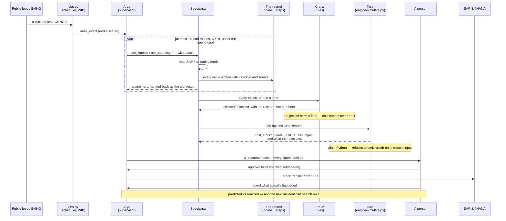
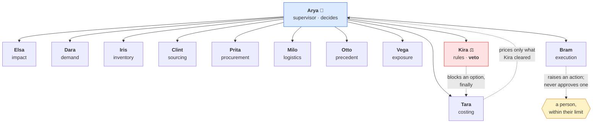
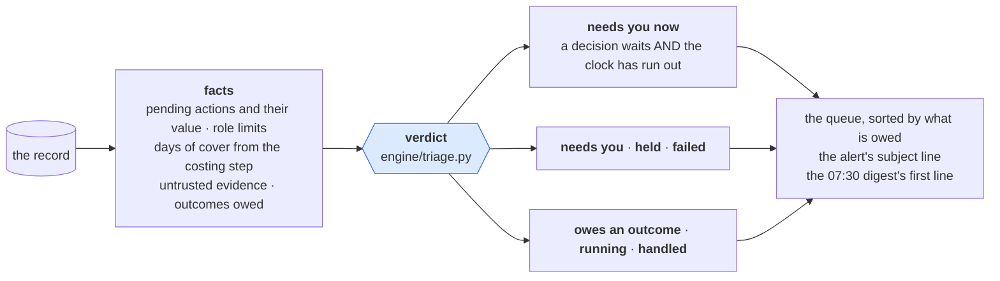
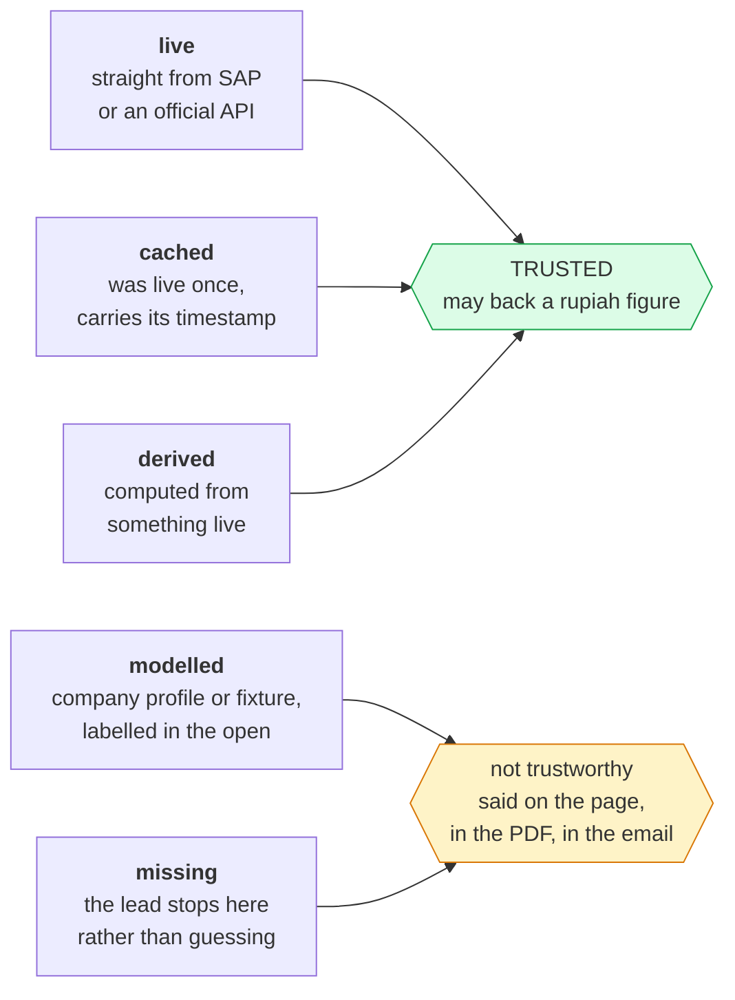
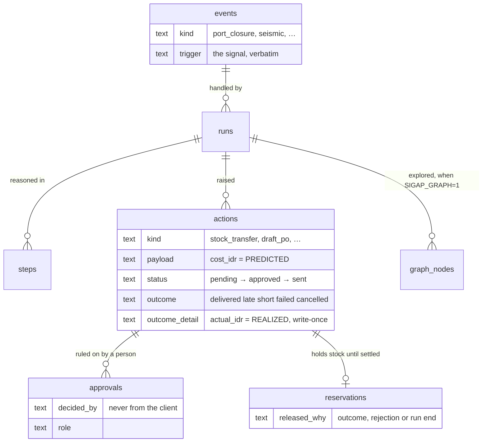
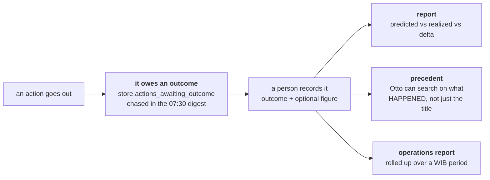
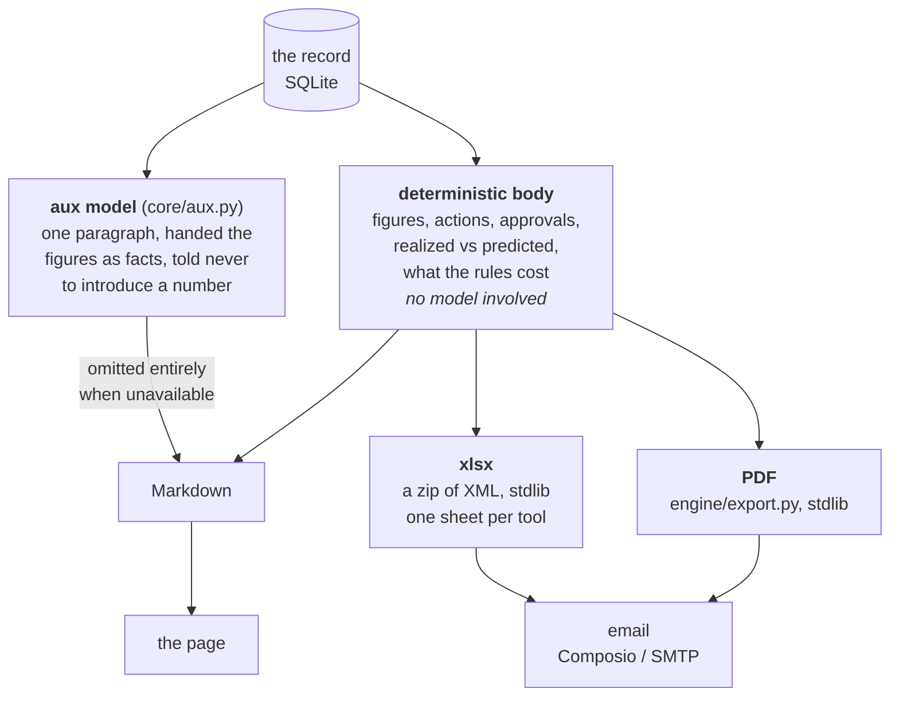
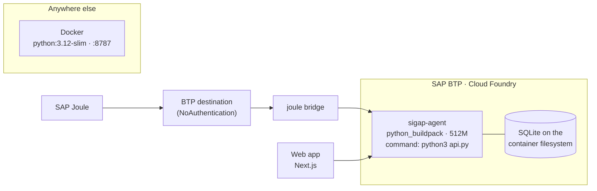

# SIGAP — Architecture

**S**upply disruption **I**ntelligence & **A**nticipation — an autonomous multi-agent
assistant for Indonesian manufacturers. A disruption arrives as a signal, twelve agents
investigate it, the arithmetic prices the options, the rules strike out the ones that
break a contract or a regulation, and what is left reaches a person as a decision they
can approve — with every figure carrying where it came from.

Built for the **SAP + AWS Hackathon Indonesia 2026**, Supply Chain track.

**This page is the one-page overview: the stack, the diagrams, and the decisions.** It is
written to be read in ten minutes, by a judge, a mentor or somebody joining the team.

For depth, [`architecture/`](architecture/) holds one file per concern — the web app, the
agent team, the tools and the data path, the workers, the record — each read from the code
as it stands. Where that folder and this page disagree, **that folder is right**: it is
maintained against the code, this one summarises it.

| Also |  |
|---|---|
| [`../README.md`](../README.md) | What the system does, at length |
| [`DEMO.md`](DEMO.md) | The 6–7 minute demo storyboard, with judge Q&A |
| [`PITCH-5-SLIDES.md`](PITCH-5-SLIDES.md) | The deck outline: five content slides |
| [`AGENT-REFERENCE.md`](AGENT-REFERENCE.md) | Every tool's parameters, generated from the registry |
| [`ENV.md`](ENV.md) | Every environment variable, and how to check it works |

---

## 1. The shape of it



Everything in that picture is what is actually deployed, read from `ops/CICD.md`,
`ops/server-config/` and the code — not a target state. The numbers are the flow:

| | |
|---|---|
| **1** | The watchers poll public feeds on their own schedule — BMKG every 5 minutes, GDACS/EONET/USGS every 30, Open-Meteo every 3 hours. A hit near a watched plant or port that the record has not seen becomes an event. No credential, every answer cached with the time it was **really** fetched. |
| **2** | Tools read SAP S/4HANA over OData; with no API key they fall back to an upload or the fixture and the value is labelled `cached` or `modelled` — never invented. |
| **3** | **One Python process** holds the HTTP service, the twelve agents, the schedule and the workers. Standard library only. Arya delegates, Kira ⚖️ rules, Tara prices what cleared. |
| **4** | Each agent's model is resolved per call on Amazon Bedrock. The two deciders stay on Claude; the ten specialists may run on a cheaper model, because the veto and the arithmetic are Python and do not move with the model. The instance's IAM role grants Bedrock — **no key on disk**. |
| **5** | SAP AI Core serves `gpt-5.4` as a second brain that spends no AWS credit, and `sap-rpt-1.6` ranks delivery-slip risk for Vega. |
| **6** | The same tool registry is served as **MCP** over `POST /mcp`, for AWS AgentCore Gateway and for SAP Joule. A `missing` origin crosses as an MCP **error**, never as a value someone might read as real. |
| **7** | A person approves inside their own limit, checked server-side from the session token — the client never sends an identity. |
| **8** | The record: every event, step, action, approval, reservation and outcome, in one SQLite file on the instance's EBS volume. |
| **9** | What leaves: alerts and reports by email, team channels, PDF and Excel written by hand, and approved actions posted to SAP with an idempotency key. |

To change the picture, edit the `CONTENT` section of
[`architecture/diagram.py`](architecture/diagram.py) and run it. It computes the layout
and **refuses to write a diagram that is wrong**: nothing may escape the box it was
declared inside, no two tiles in a group may overlap, and no label may run out of its
tile. There is a [PNG beside it](architecture/sigap-aws-architecture.png) at 2× for
slides; PowerPoint and Google Slides take the SVG directly.

**Why the agent service has no dependencies.** `http.server`, `sqlite3`, `urllib`,
`hmac`, `zipfile` — the standard library does all of it, including writing the xlsx
(a zip of XML) and the PDF (`engine/export.py`). One package is installed, and only
when a Bedrock model is configured: `anthropic[bedrock]==0.125.0`, pinned, because
later SDKs send an API version the ARN-versioned Bedrock models reject with a 400.
SAP AI Core needs nothing at all — `clients/aicore.py` is `urllib`.

The point is not minimalism for its own sake. It is that the thing a judge, a mentor or
an auditor has to trust can be read end to end, and that it starts on any machine with
Python on it.

---

## 2. Tech stack, and why each piece

| Layer | Choice | Why this one |
|---|---|---|
| Agent runtime | **Python 3, standard library** (`http.server`, `sqlite3`, `urllib`, `hmac`) | Readable end to end; no supply chain of its own; starts anywhere |
| Record | **SQLite**, WAL, one file (`core/store.py`) | The approvals table is the official record of who authorised what. One file, transactional, no server to go down |
| Web app | **Next.js 16.3.4** · React 19.2.8 · **Tailwind v4** · shadcn/radix · d3 | Server components keep the session token and the service URL off the browser; d3 for the charts that have to be exact |
| Models (AWS) | **Amazon Bedrock** on Mantle — Claude (Anthropic Messages), MiniMax / DeepSeek / Kimi (OpenAI Chat Completions) | The deciders run on the strongest model; the ten specialists can run cheaper without weakening a single guarantee |
| Models (SAP) | **SAP AI Core** — `gpt-5.4` chat, `anthropic--*` deployments, **`sap-rpt-1.6`** tabular prediction | A second brain that spends no AWS credit, and SAP's own tabular model ranks delivery slip for Vega |
| Enterprise data | **SAP S/4HANA Cloud** (OData, API key) | Stock, BOM, purchase orders, customer orders, suppliers — the system of record |
| Integration out | **MCP** (JSON-RPC over POST) · **A2A** (a2a-sdk, FastAPI) | AWS AgentCore Gateway speaks MCP; SAP Joule speaks both |
| Email | **Composio** (holds the Gmail OAuth grant) or plain SMTP | SIGAP holds one project key, never the mailbox's password or token |
| Reports | `engine/export.py` — **xlsx and PDF written by hand**, stdlib | No reporting dependency, and a download says exactly what the log says |
| Deployment | **Cloud Foundry** (`manifest.yml`, python buildpack) or **Docker** (`python:3.12-slim`) | The hackathon space takes `cf push`; the container runs anywhere else |

### What is deliberately *not* in the stack

- **No vector database, no RAG.** The rules are a file a person signs off
  (`references/rule-pack.json`), each rule carrying its value, the document it was read
  from, and whether a human checked it there. A retrieved paragraph cannot carry that.
- **No ORM, no migrations framework.** One schema string, `CREATE TABLE IF NOT EXISTS`.
- **No model in the arithmetic.** `engine/simulate.py` has no model in it at all.

---

## 3. One disruption, end to end



That is the default path: the lead delegates one specialist at a time, and the shared
board is the evidence of the handling. Two flags, both off by default, change the
mechanics without changing a single guarantee:

| Flag | What it turns on |
|---|---|
| `SIGAP_GRAPH=1` | The **exploration graph**: a persisted, typed DAG in SQLite. Every fact becomes a node with its origin, Clint's options become `option` nodes, Kira's rulings become `ruling` nodes, and a deterministic planner (`engine/planner.py`) opens the next leads — a price lead only for an option whose ruling is `allowed`, so a blocked option is never costed. Fail-open: a graph error never touches the handling. Served by `GET /runs/{id}/graph` |
| `SIGAP_SWARM_ASYNC=1` | **Parallel dispatch** (`engine/dispatch.py`): leads are claimed off the graph and worked by several specialists at once on a thread pool. `claim_next_lead` is one `UPDATE … WHERE state='open'` whose `rowcount == 1` is the atomic compare-and-swap, so two workers cannot take the same lead. `core/admission.py` bounds how many run at once |

They are meant to be switched on together — the dispatcher reads its frontier from the
graph. With both off the handling runs exactly as drawn above.

### The scheduler

Seven jobs, Jakarta time. `core/schedule.py` runs them; a job is `every N seconds` or
`at "HH:MM"` WIB.

| Job | Cadence | What it does |
|---|---|---|
| `bmkg` | 5 min | Earthquakes near a plant, from BMKG |
| `hazards` | 30 min | Cyclones, floods, quakes near a port or plant (GDACS, NASA EONET, USGS) |
| `weather` | 3 h | Gales, high seas, heavy rain forecast (Open-Meteo) |
| `exposure` | weekly | Vega's scan for risk that has not happened yet |
| `certificates` | daily | TKDN certificates running out, which no feed can see — the lapse is in the company's own rule pack, and the local content behind it goes when it does |
| `notify` | 30 s | Deliver queued alerts and approved outward messages |
| `sap_send` | 10 min | Send approved actions to SAP |
| `digest` | 07:30 WIB | The morning digest, including what still owes an outcome |

---

## 4. The agent layer

Twelve agents: one supervisor, one with a veto, ten specialists. Each is a prompt
(`prompts/*.txt`), a set of tools (`core/registry.py`), and a model it may run on.
46 tools in all.



**The veto is Python, not a prompt.** `tools/simulation.py` re-runs
`check_local_constraints` on every option itself rather than taking the model's word for
which ones were cleared: the caller is a model, and a list it hands in can only *narrow*
the rules, never widen them. That is why a cheaper specialist model cannot weaken a
single guarantee — Kira's veto, Tara's figures and every origin label are code.

### How work is handed out

Each specialist is offered to the lead as **one tool**, `ask_<code>`, whose description
is that specialist's nickname, title and brief — with `HAS VETO.` appended for Kira. A
specialist sees only its own tools, so **specialists cannot call one another**: every
hand-off goes through the lead, and the trail has one shape.

A handling is bounded on three axes, so it cannot run away: at most 14 lead rounds, 600
seconds, and a spend cap (`SIGAP_COST_CAP_IDR`, default Rp 500,000). Hit one and
`graph._salvage` lists what was actually found, with each origin, and writes **no**
recommendation — a partial answer is labelled partial rather than dressed up as a whole
one. One specialist raising an error does not end the handling; it comes back as a failed
finding and the lead carries on without it.

---

## 5. The verdict: what a person still owes

A queue of twenty disruptions is useless if the reader has to open each one to
learn which needs them. So every handling carries a verdict — and the verdict is
**arithmetic** (`engine/triage.py`), not an opinion.

That is the same decision as Kira's veto, for the same reason. A model that says
"this is critical" has made exactly the kind of confident, unlabelled claim this
system refuses: it cannot be recomputed, it cannot be argued with, and it would
drift the day the specialists move to a cheaper model — which they are meant to
be able to do.



Two rules hold it together:

- **A verdict never says a word without the number that earns it.** Not
  "critical" but *"Approve now — Rp 94,000,000 waiting, stock out in 3 days"*.
  Every line of its reasoning is a fact a reader can go and check.
- **A verdict is about what is owed, not how dramatic something is.** "Needs you
  now" and "handled" are instructions. "High" and "medium" are adjectives, and
  nobody has ever known what to do with an adjective.

The states are the sort order, so the top of the screen is always the thing most
owed: `needs_you_now · needs_you · held · failed · owes_outcome · running ·
handled`. A handling with no costing step gets **no clock** rather than an
invented one — otherwise every queue looks like an emergency.

And one claim is guarded above all: the board may only read **"nothing needs a
person"** when nothing waits, nothing was held, nothing failed and nothing owes
an outcome. A screen that says all-clear while four handlings sit held is
believed exactly once.

## 6. Provenance: the spine of the whole thing

Every value a tool returns is a `Result` carrying an `Origin`. Nothing in SIGAP shows a
number without saying where it came from.



Three places this is enforced rather than merely displayed:

1. **`engine/simulate.py` refuses.** Hand it untrusted stock or options and it returns a
   refusal with a reason, not a figure. A rupiah amount on a planner's screen is never
   a guess with a confident font.
2. **`weakest()` propagates.** A result assembled from five reads carries the weakest
   origin among them, so one modelled input cannot hide behind four live ones.
3. **Approval limits are server-side.** `core/identity.py` holds them, and the client
   never sends an identity: planner `read-only`, buyer `Rp 500,000,000`,
   procurement_lead and admin `Rp 10,000,000,000`. Autonomy below
   `SIGAP_AUTONOMOUS_LIMIT_IDR` (default Rp 50,000,000).

---

## 7. The record, and the loop that closes it



`outcome`, `outcome_at` and `outcome_detail` are columns on `actions`, not a table of
their own: an outcome is the second half of an action's record, written once, and giving
it its own row would allow two of them.

The learning loop is deliberately **record-and-show**, not record-and-influence: an
outcome never moves a score or a ranking. It does three things.



Two rules this code holds, both because the alternative falsifies a number:

- **A realized cost is a number or it is absent.** `store.outcome_detail()` raises on a
  string: in Indonesian, "Rp 24,5 jt" and "24.500.000" put the same digits a thousand
  times apart, so any parser must *guess* the scale, and a guessed rupiah on a portfolio
  tile is indistinguishable from a read one.
- **A delta is only claimed where both halves exist.** `settled_actions` counts recorded
  outcomes; `settled_with_cost` counts the ones that can be compared. The report draws
  the delta from the second — printing the first beside it is what once made three
  outcomes with no figures announce "exactly at prediction".

---

## 8. Reporting



Four properties worth knowing:

- **A number in a report can be recomputed from the same rows by anyone.** The model
  writes prose and nothing else; with no model configured the report is still whole.
- **Periods are WIB calendar periods.** `?days=30`, or `?since=&until=`. Midnight on
  1 October in Jakarta is 17:00 on 30 September in UTC, and a window that ignored that
  would file the first seven hours of every month under the month before.
- **What the rules cost is on the record.** `engine/simulate.py` prices every option
  including the ones Kira struck out, so the report can say *"the compliant plan cost
  Rp 46,000,000 more than the cheapest one, and here is the rule that struck it"*.
  Without that the veto is an assertion; with it the veto has a price.
- **An emailed workbook leaves the raw rows behind.** The per-tool sheets hold supplier
  prices; inside the company that is the audit trail, attached to an email it is a data
  export nobody asked for (`SIGAP_REPORT_EMAIL_DATA` to opt in).

---

## 9. Repository map

```
socrates/
├── app/                      Next.js app router — the web app
│   ├── (app)/                disruptions · reports · agents · data · log · uploads …
│   ├── api/sigap/[...path]/  the only bridge to the agent service; attaches the session
│   └── lib.ts                types, idr(), wib() — one timezone for the whole UI
├── components/               shadcn/radix UI, charts (d3), status and origin badges
└── sigap/
    ├── agent/                THE PRODUCT — Python, stdlib only
    │   ├── api.py            HTTP surface, ~40 routes, one dispatcher
    │   ├── graph.py          the agent loop (Anthropic-shaped, any model)
    │   ├── jobs.py           the eight scheduled jobs
    │   ├── notify.py         alerts, digest, reports by email
    │   ├── mcp.py            the tool registry, spoken as MCP
    │   ├── core/             store · identity · provenance · registry · llm · aux
    │   │                     exploration · admission · schema · config · trace
    │   ├── agents/           the twelve definitions
    │   ├── prompts/          one prompt per agent
    │   ├── tools/            46 tools, grouped by agent
    │   ├── engine/           simulate · allocate · forecast · planner · report · export
    │   ├── clients/          sap_s4 · aicore · composio · channels · feeds · web_data
    │   ├── signals/          bmkg · hazards · weather · places · watch
    │   └── fixtures/         the Ningbo scenario
    ├── joule/                the A2A bridge: FastAPI + a2a-sdk, three read-only skills
    └── references/           the rule pack — installed per deployment, never committed
```

Every module carries a `demo()` self-check. `python3 manage.py check` runs all of them:
**56 modules, 12 agents, 46/46 tools, 12/12 prompts.**

---

## 10. Deployment



**One warning the manifest carries in writing.** On Cloud Foundry, SQLite lives on the
container filesystem, which is reset on every restart, redeploy and scale. The approvals
table is the official record of who authorised what, so on that platform it survives
only until the next restart. Fine for a demo. Before anything real: bind Postgres and
move `core/store.py` onto it.

### Configuration that matters

| Variable | What it governs |
|---|---|
| `SIGAP_SECRET` | Signs session tokens. Without it they can be forged, so the service says so and refuses |
| `SAP_API_KEY` | S/4HANA. Absent → `Origin.MISSING`, never invented data |
| `AWS_REGION` + credentials | Bedrock on Mantle |
| `AICORE_SERVICE_KEY` | SAP AI Core; absent → the model reports not-ready |
| `SIGAP_MODEL*` | Which model each agent runs on (per agent, specialists, deciders, fallback) |
| `SIGAP_AUTONOMOUS_LIMIT_IDR` | What the system may do on its own authority (default Rp 50,000,000) |
| `SIGAP_RULE_PACK` | Where the rule pack is read from |
| `SIGAP_ENV` | Non-production redirects every outward message to `SIGAP_EXTERNAL_REDIRECT`, marked `[TEST]` |

---

## 11. The decisions this architecture is making

| Decision | What it buys | What it costs |
|---|---|---|
| Stdlib-only agent service | Auditable end to end; runs anywhere; no dependency risk | We write the xlsx and the PDF ourselves |
| SQLite as the record | Transactional, one file, no server | One writer; Postgres needed before multi-tenant |
| The arithmetic has no model in it | A rupiah figure can be recomputed by anyone | The model cannot "estimate" a gap, and will not pretend to |
| The veto is code, re-checked | A cheap specialist model cannot weaken compliance | The rules must be written down, not inferred |
| Provenance on every value | A planner can tell a fact from an assumption | Every tool must return a `Result`, every time |
| Outcomes recorded, not fed back into scoring | No silent drift in how decisions are made | Learning is a human reading a report, for now |
| Two model providers (AWS + SAP) | Cost control, and no single point of failure | One translation layer (`core/llm.py`) to maintain |

---

## 12. Honest state

What is real: the agent loop, all 46 tools, the rules engine, the costing engine, the
record, approvals and limits, the reports and their files, the signal watchers, MCP, the
A2A bridge, and the outcome loop. All of it self-checked, 56 modules.

What is demo-grade, and says so on screen:

- The installed **rule pack is `verified:false`** throughout — the mechanism is real, the
  Ningbo values are illustrative. Filling it with contract figures is the customer's
  domain work, and until then every ruling that uses one is labelled `modelled`.
- **SQLite on Cloud Foundry** does not survive a restart (§10).
- The **SAP write path** sends approved actions but has not been run against a customer
  tenant.

What comes next, in order: Postgres; a verified rule pack; the SAP write path tested end
to end; then — and only then — letting recorded outcomes influence the ranking.
