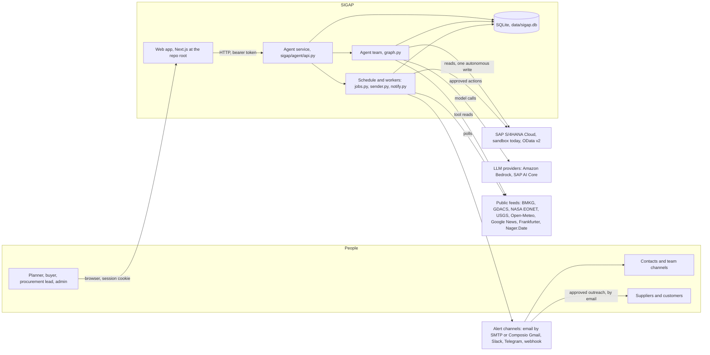
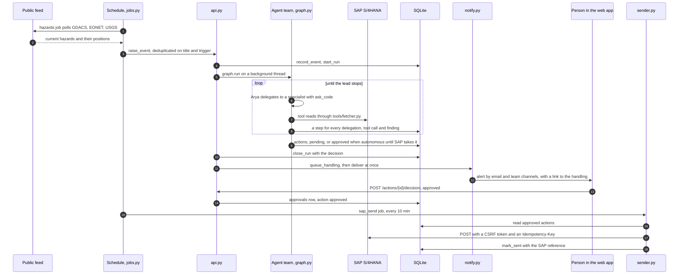

# SIGAP, architecture

> How the parts fit together: who calls whom, what runs without a person, and where
> every record ends up. One concern per file. Read from the code as it stands; where
> another document disagrees with these pages, the code is right and these pages say so.

Looking for the short version — the tech stack, why each piece was chosen, and the
diagrams on one page? That is [`../ARCHITECTURE.md`](../ARCHITECTURE.md). It summarises
these files; these files are the ones kept against the code.

| Also in this folder | |
|---|---|
| [`sigap-aws-architecture.svg`](sigap-aws-architecture.svg) | The reference architecture as one picture, in AWS's own diagram idiom. [PNG at 2×](sigap-aws-architecture.png) for slides |
| [`diagram.py`](diagram.py) | What draws it. Edit the `CONTENT` section and run it: the layout is computed, and it refuses to write a diagram whose boxes overlap, escape their parent, or whose labels run past their tile |

| File | What it covers |
|---|---|
| [`app.md`](app.md) | The Next.js web app: its pages, how a page reaches the agent service, the session, file downloads |
| [`agents.md`](agents.md) | The twelve agents, the lead and its delegation, Kira's veto, one handling from start to finish, the model each agent runs on, the autonomy limit |
| [`tools.md`](tools.md) | The tool registry and all 46 tools by owner, the path every read takes (SAP, an upload, the fixture), origin labels, the deterministic engines, the rule pack |
| [`workers.md`](workers.md) | What runs without a person: the HTTP service, the schedule and its eight jobs, the signal watchers, the SAP sender, the alert outbox and its channels |
| [`data.md`](data.md) | The SQLite record table by table, the fixtures, and every output: reports, workbooks, the trace, alerts, SAP writes, the generated agent reference |

Conventions used on every page:

- A Python path such as `core/store.py` is relative to `sigap/agent/`. A path that starts
  with `app/`, `components/` or `lib/` is relative to the repository root, where the web
  app lives.
- Environment variables are named, never valued. `../ENV.md` has what each one does.

Other documents this folder leans on: `../DESIGN.md` (the scenario and its figures),
`../DATA-SOURCES.md` (what was verified about each source), `../agent/README.md` (how to
run it), `../AGENT-REFERENCE.md` (every tool's parameters, generated from the registry).

---

## System context

SIGAP runs as two processes: the web app (Next.js) and the agent service
(`api.py`, one Python process holding the HTTP server, the agent team, the schedule and
the workers). They share nothing but HTTP. The record is one SQLite file that only the
agent service opens.

| Box | Where it is | Detail in |
|---|---|---|
| Web app | `app/`, `components/`, `lib/` at the repo root | `app.md` |
| Agent service | `api.py`, stdlib `ThreadingHTTPServer`, port 8787 by default | `workers.md` |
| Agent team | `graph.py`, `agents/definitions.py`, `prompts/*.txt`, `core/llm.py` | `agents.md` |
| Tools | `tools/*.py`, one file per agent, registered in `core/registry.py` | `tools.md` |
| Schedule and workers | `core/schedule.py`, `jobs.py`, `signals/*.py`, `sender.py`, `notify.py`, `clients/channels.py`, `clients/composio.py` | `workers.md` |
| SQLite | `core/store.py` (and the `users` table in `core/identity.py`), file at `SIGAP_DB` | `data.md` |
| SAP S/4HANA | `clients/sap_s4.py` (transport), `clients/sap_map.py` (rows the tools speak) | `tools.md` |
| LLM providers | `core/llm.py` routes `bedrock`, `bedrock-openai` and `aicore` models; `clients/aicore.py` for AI Core; `core/aux.py` for report prose | `agents.md` |
| Public feeds | `clients/feeds.py` (one GET, one cache), `clients/web_data.py`, `signals/*.py` | `workers.md`, `tools.md` |
| Alert channels | `clients/channels.py`; Gmail through `clients/composio.py` | `workers.md` |

Two more callers reach the same service, outside the web app. `POST /mcp` (`mcp.py`)
serves the tool registry as MCP for AWS AgentCore Gateway and SAP Joule, behind the same
session check as every other route; `../joule/` holds the Joule shim that calls it and
`GET /exposure`. Neither runs a model on SIGAP's side.

---

## How a disruption flows, end to end

A watcher (or a person, through `POST /events`) raises an event. The agent team works it
on a background thread, every step lands in the record, the alert goes out, a person with
enough authority approves, and the sender pushes the approved action into SAP on its next
pass.

What each numbered hop is made of:

1. to 3. `jobs.py` `hazards` calls `signals/hazards.sweep`, which fuses one storm seen by
   two feeds into one hazard and measures it against `signals/places.watched()`. A hit
   that `store.event_exists()` has not seen becomes an event through the same
   `api.raise_event()` that `POST /events` uses.
4. and 5. `raise_event` writes the event and a run. With a model the lead can call it
   starts `_handle` on a daemon thread; without one the run is closed `held` at once and
   nothing is guessed.
6. to 8. `graph.run` (sync by default, `engine/dispatch.py` under `SIGAP_SWARM_ASYNC=1`).
   Each delegation, tool call and finding is a `steps` row written by the `report`
   callback in `api._handle`. `agents.md` has the loop.
9. An action is a row in `actions`, keyed by content so a retry cannot duplicate it.
   Only an internal stock transfer under the autonomy limit, on evidence that is all
   trusted, goes ahead without a person (`tools/execution.py autonomy_check`).
10. to 12. `notify.queue_handling` writes one outbox row per recipient and channel;
    `api._tell` then runs the `notify` job immediately instead of waiting 30 seconds.
13. to 14. The decision route checks the action's value against the role's limit from the
    session token, never from the request body (`core/identity.py`).
15. to 18. `sender.send_approved` maps an action kind to an SAP service, posts it, and on
    failure leaves the action `approved` for the next pass.

The same path with no SAP key: every read falls back to an upload or the fixture and is
labelled `cached` or `modelled`, the calculator refuses to emit a rupiah figure from it,
and the sender sends nothing. With no model: the run is `held` and the alert says so.
