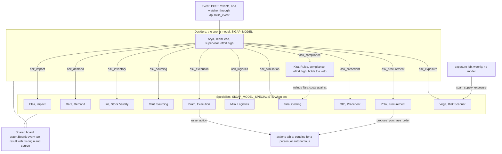
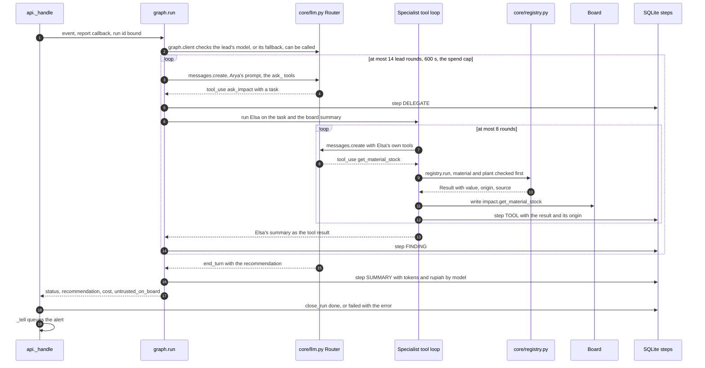
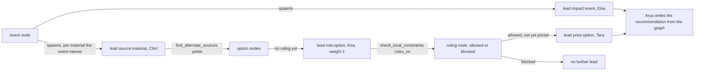

# The agent team

> Twelve agents, one lead. How the lead hands work out, how one handling runs from event
> to recommendation, where Kira's veto is held, which model each agent runs on, and the
> limit on what the team may do without a person. Paths are relative to `sigap/agent/`.

| File | Holds |
|---|---|
| `agents/definitions.py` | The twelve `Agent` records: code, nickname, title, brief, tools, effort, veto |
| `prompts/<code>.txt` | Each agent's instructions. A missing file raises `PromptMissing`; an agent is never sent to a model with a placeholder |
| `graph.py` | The orchestration: the lead's loop, each specialist's tool loop, the shared board, the cost and time limits, salvage on a stop |
| `engine/dispatch.py` | The other orchestration, behind `SIGAP_SWARM_ASYNC=1`: several specialists at once over a claimable frontier |
| `core/exploration.py`, `engine/planner.py`, `core/admission.py` | The persisted exploration graph (`SIGAP_GRAPH=1`), its deterministic planner, and the bound on how many specialists run at once |
| `core/llm.py` | Which model each agent runs on, and one interface over the wire formats those models speak |
| `core/aux.py` | The small model that writes report prose, never a figure |
| `main.py` | A scripted walk through the design scenario, with no model at all |

---

## The twelve

| Code | Nickname | Role | Effort | Tools | Note |
|---|---|---|---|---|---|
| `supervisor` | Arya | Team lead | high | 1 + one `ask_<code>` per specialist | decides who to call and when the evidence is enough |
| `impact` | Elsa | Impact | medium | 4 | orders, stock, bill of materials, customer commitments at risk |
| `demand` | Dara | Demand | medium | 3 | consumption as a variable, with a forecast |
| `inventory` | Iris | Stock Validity | medium | 3 | which stock may actually be used |
| `sourcing` | Clint | Sourcing | medium | 3 | other suppliers, internal stock, substitutes |
| `procurement` | Prita | Procurement | medium | 6 | the supplier book, quotations, the purchase order that follows |
| `logistics` | Milo | Logistics | medium | 7 | arrival dates, customs, the weather and news at a port |
| `compliance` | Kira | Rules | high | 2 | TKDN, LARTAS, holidays. **Holds the veto** |
| `simulation` | Tara | Costing | medium | 2 | deterministic costing and short-supply allocation |
| `precedent` | Otto | Precedent | medium | 1 | what was done last time, and how it ended |
| `execution` | Bram | Execution | medium | 9 | writes the actions, drafts outward messages |
| `exposure` | Vega | Risk Scanner | medium | 4 | Prevent mode: risk that has not happened yet |

45 tools in all, each owned by exactly one agent. `agents/definitions.py demo()` asserts
that what the agents claim and what `core/registry.py` holds are the same set in both
directions, that only `compliance` holds a veto, and that every tool has an activity
phrase in `api._TOOL_LABELS` and a label in `components/agent-activity.tsx`. `tools.md`
lists them.

Vega answers the lead like any specialist, and her scan also runs on its own: the
`exposure` job and `GET /exposure` call her tools straight through the registry with no
model (`workers.md`).

---

## Delegation

There is no fixed pipeline. Each specialist is offered to the lead as one tool,
`ask_<code>`, whose description is the specialist's nickname, title and brief, with
"HAS VETO." added for Kira (`graph._specialist_tools`). The lead's tool list is those
eleven plus its own `detect_disruption`. A specialist sees only its own tools
(`registry.schemas_for_model(code)`), so specialists cannot call one another: every
hand-off goes through the lead.

When the lead calls `ask_<code>` with a task, `graph._tool_loop` runs that specialist to
completion and hands its summary back as the tool result. The specialist's prompt is the
task, then what is on the shared board right now (each key with its origin and source),
then "if data you need is unavailable, say what is missing, do not guess".

The **board** (`graph.Board`) is the evidence of one handling. Every tool result is
written to it under `<agent>.<tool>` together with its origin, source and fetch time, as
one `Entry`, so a value cannot exist on the board without saying where it came from.
`Board.untrusted_keys()` is every entry that is not `live`, `cached` or `derived`; that
list travels into the run's decision (`untrusted_on_board`), the alert, the report, and
Bram's autonomy check.

A tool result that is a long list is cut to the first 50 rows for the model
(`MODEL_ROWS`), with the total and a request to narrow the filter. The trail keeps every
row.

---

## One handling

`api.raise_event` records the event and a run, then starts `api._handle` on a daemon
thread. `_handle` binds the run id (`registry.bind_run`) so any action a tool raises lands
on this run, and passes `graph.run` a `report` callback that writes each piece of progress
as a `steps` row: `DELEGATE` when the lead hands out a task, `TOOL` for every tool call
(arguments, result, origin, source, milliseconds), `FINDING` when a specialist reports
back, `SUMMARY` for the lead's final text, `FALLBACK` when another model answered.

How a handling ends (the value `graph.run` returns, stored as `runs.decision`):

| Ending | `decision.status` | Run status | Cause |
|---|---|---|---|
| The lead writes its answer | `done` | `done` | `end_turn` from the lead |
| A limit is hit | `partial` | `done` | `BudgetExhausted` (spend over `SIGAP_COST_CAP_IDR`, default Rp 500,000) or `DeadlineExceeded` (600 s). `graph._salvage` lists what is on the board with each origin and writes no recommendation |
| Out of lead rounds | `stopped` | `done` | more than `MAX_LEAD_ROUNDS` (14) |
| Anything else raised | | `failed` | the error is stored on the run |
| No model the lead can call | `held` | `held` | `raise_event` closes the run at once; nothing runs |

Inside the loop:

- One specialist raising does not end the handling. `_run_specialist_isolated` reports
  it as a failed finding and tells the lead to carry on without it. Only a budget or
  deadline stop is global.
- A specialist that held tools and called none gets its summary prefixed with a warning
  that nothing in it was read or done, because the lead cannot tell prose from a
  recorded action.
- A tool that raises, or a tool name that is not registered, comes back to the model as
  an error result and writes nothing to the board.
- Spend is priced per call at the rate of the model that answered (`llm.price_idr`), kept
  per model in `Cost.by_model`, and summed into `runs.token_cost_idr`.

### Kira's veto

A rejection from Kira is final on cost. Where that is held:

1. `tools/compliance.py check_local_constraints` rules one option at a time from the rule
   pack, the company profile and the holiday calendar, and returns `allowed` with a
   reason that names the rule and the numbers. The ruling is Python, whatever model Kira
   runs on.
2. Tara's `simulate_scenario` costs only options that cleared. It asks
   `check_local_constraints` itself for every option (`rulings_for`), whatever it is
   called with: `allowed_options` can only narrow the rules' rulings, and an option the
   rules struck out stays out even when the list names it, with a note saying so. It also
   reports
   `compliance_cost`: what obeying the rules cost when a struck-out option would have been
   cheaper, and which rule struck it.
3. The prompts: `prompts/supervisor.txt` (rule 1, never recommend an option Kira
   rejected), `prompts/execution.txt` (never act on one, not at a lower quantity, not as a
   partial), `prompts/compliance.txt`.
4. With the exploration graph on, Kira's ruling is a `ruling` node and the planner opens
   a price lead only for an option whose ruling is `allowed`, so a blocked option is never
   costed through the graph. `engine/planner.blocked_option_reject` is the gate that
   reads it.

---

## Models per agent

`core/llm.py` names a model `provider:model`. Three providers:

| Provider | Wire format | Where |
|---|---|---|
| `bedrock` | Anthropic Messages | Claude on Amazon Bedrock |
| `bedrock-openai` | OpenAI Chat Completions | other models on Bedrock (MiniMax, DeepSeek, Kimi, Qwen, GLM …) |
| `aicore` | Chat Completions, or Anthropic Messages for `anthropic--*` deployments | SAP AI Core (`clients/aicore.py`), for example `gpt-5.4` |

Each agent's model is resolved per call (`llm.resolve`). A choice saved on the Models page
(`POST /models`, stored in the `settings` table as `model.<key>`) wins over the variable at
the same level, and a more specific level wins over a broader one:

| Order | Level | Page key | Variable |
|---|---|---|---|
| 1 | one agent | `<code>` | `SIGAP_MODEL_<CODE>` |
| 2 | the ten specialists that neither lead nor hold the veto | `specialists` | `SIGAP_MODEL_SPECIALISTS` |
| 3 | the lead, and everyone not set above | `lead` | `SIGAP_MODEL` (default `anthropic.claude-opus-5`) |
| | fallback, tried once when an agent's own model fails, then kept for the rest of the handling | `fallback` (`none` switches it off) | `SIGAP_MODEL_FALLBACK` |
| | the aux model for report prose | `aux` | `SIGAP_AUX_MODEL` (default `anthropic.claude-haiku-5-5`) |

Arya and Kira skip level 2 (`llm._deciding`): the agent that decides what to do and the
one that decides what may be done stay on the strong model unless set one by one.

One `llm.Router` serves one handling. It routes each request to the model the request
names, builds the backend for that model once, and remembers a model that failed so it
is not retried on every round. Adaptive thinking and `output_config.effort` are asked for
on every request; `core/llm.py` drops them for a model that cannot take them. A reply from
the fallback carries `fell_back_from`, which becomes a `FALLBACK` step.

`GET /health` and `GET /models` report every agent's model and whether it can be called.
With `SIGAP_ENV=prod`, `core/config.load()` refuses to start when the lead's model cannot be
called (`llm.production_gaps`).

The aux model (`core/aux.py`) is a separate, fail-open call: it writes the executive
summary of a report from figures it is handed (`engine/report.py`), returns `None` on any
failure, and never sits on a figure or a decision.

Two tools also call a model, outside the agents' own loop: Milo's `web_brief` asks
`sonar` on SAP AI Core one question and returns its answer labelled `derived`, and Vega's
`rank_po_slip_risk` asks SAP RPT-1.6 on AI Core to predict slip, labelled `modelled`.

---

## The autonomy limit

`SIGAP_AUTONOMOUS_LIMIT_IDR` (default Rp 50,000,000) is the ceiling for an action taken
without a person. The prompts name it through the placeholder `{AUTONOMOUS_LIMIT}`, which
`Agent.instructions` fills from the config (`CFG.autonomous_limit_text`), so a prompt
never carries a stale number.

`tools/execution.py autonomy_check(cost_idr)` lets an action go alone only when all of
these hold:

1. the cost is under the limit;
2. it was raised inside a handling (there is a board);
3. nothing on the board, apart from Otto's precedent search, is `modelled` or `missing`;
4. something was read before deciding.

Only `create_stock_transfer` asks this question. Every other action that changes
something outside SIGAP is recorded `pending` and waits for a person whatever its value:
`create_draft_po`, `propose_purchase_order`, `create_sourcing_event`,
`propose_safety_stock_change`, `draft_customer_notice`, `request_supplier_update`.
`notify` and `monitor_shipment` are internal records, written with status `sent` at once.

A person's own limit is separate and comes from the session token (`app.md`, Session and
authority). The decision route refuses an approval over that limit, and
refuses a supplier request below a buyer and a customer notice below a procurement lead.

---

## The other orchestration: async dispatch and the exploration graph

Two flags, both off by default, change how a handling runs. They are written so that with
both off the handling runs exactly as above.

| Flag | What it turns on |
|---|---|
| `SIGAP_GRAPH=1` | The exploration graph: every board write is mirrored into `graph_nodes` and `graph_edges` as a `fact` with its origin; Clint's options become `option` nodes and Kira's rulings `ruling` nodes; the planner opens the next leads. Fail-open: a graph error never touches the handling. `GET /runs/{id}/graph` serves it |
| `SIGAP_SWARM_ASYNC=1` | `engine/dispatch.handle_event_async` replaces the lead's loop: open leads are claimed from the graph and run as specialist loops on a thread pool, several at once, and Arya writes the recommendation once, from the settled graph, with no tools |

The planner is deterministic (`engine/planner.py`), because the mitigation chain is a
known one:

| Piece | Detail |
|---|---|
| Lead states | `open` → `claimed` → `worked`, `capped`, `blocked`, `failed` or `stopped`. A claim is one `UPDATE … WHERE state='open'`, so two workers cannot take the same lead. At most 3 attempts per lead (`MAX_LEAD_ATTEMPTS`); a terminal lead can be revived once |
| Routing | `dispatch._ROUTE` maps a lead's kind to a specialist and a task: `impact`, `source`, `rule`, `price`, and also `demand`, `stock`, `logistics`, which the planner does not open today |
| Concurrency | `SIGAP_ASYNC_WORKERS` threads (default 4, 1 to 16). `core/admission.py` bounds work per operator and globally (`SIGAP_FAIR_ADMISSION`, `SIGAP_GLOBAL_SLOTS` default 8, `SIGAP_PER_OPERATOR_SLOTS` default 4); a refused lead goes back to the frontier without burning an attempt |
| Convergence | No lead open or claimed and nothing in flight |
| Stops | The same spend cap and 600 s deadline: the dispatcher stops claiming, lets work in flight drain, and the same salvage applies |

Async dispatch reads its frontier from the graph, and the mirror and the planner both
check `SIGAP_GRAPH`, so the two are meant to be switched on together. With only
`SIGAP_SWARM_ASYNC=1` the dispatcher works the seeded leads and nothing chains from them.

---

## Other ways an agent runs

| Entry | What runs | Records |
|---|---|---|
| `POST /agents/{code}/ask` (the conversation page) | `graph.ask_specialist`: one specialist's tool loop on the question, with earlier turns of the conversation as history and optional attachments (images, PDFs, text) | `conversations` and `messages`. No run is open, so `raise_action` returns `missing` with "raise it from a signal rather than from a question" and no action is written |
| `POST /mcp` (`mcp.py`) | The registry's tools, called directly; no model | nothing beyond what a tool writes; a `missing` result is returned as an MCP error |
| `GET /exposure`, the `exposure` job | `scan_supply_exposure` and `rank_po_slip_risk` through `registry.run`; no SIGAP model | the job raises the top three findings as events |
| `python3 main.py` | A fixed walk through the Ningbo scenario: the tools called in the design's order, hard-coded rulings (D and E blocked) labelled modelled, the real calculator. No model is called | a JSON trace file only (`--out`) |
| `python3 graph.py` | The orchestration's self-check, on a scripted stand-in for the model, on fixtures and a scratch database | nothing in the real record |
