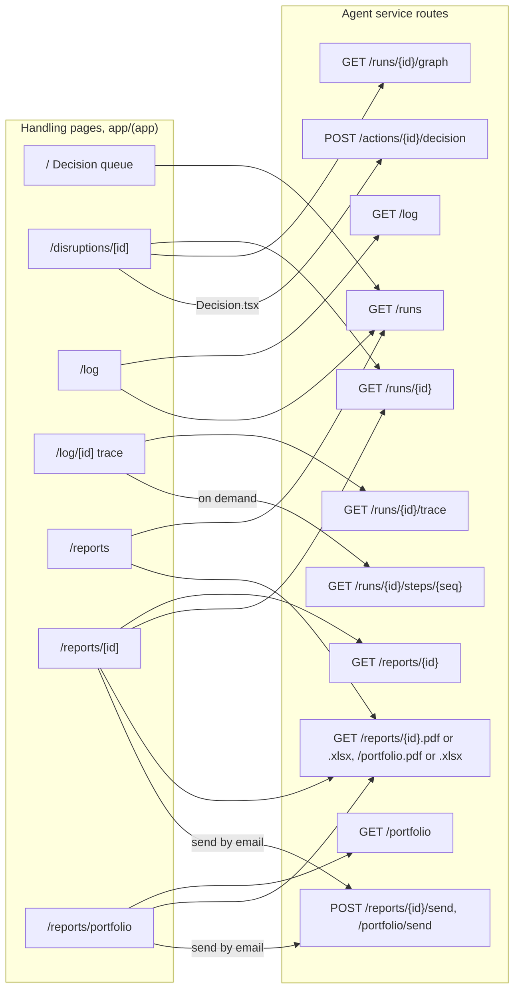
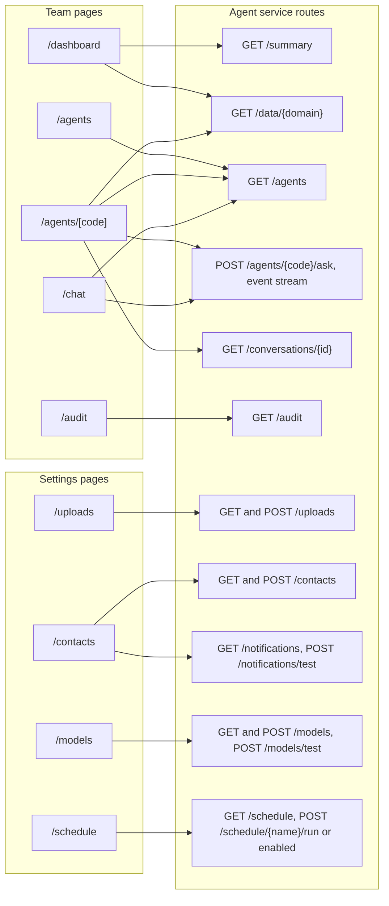
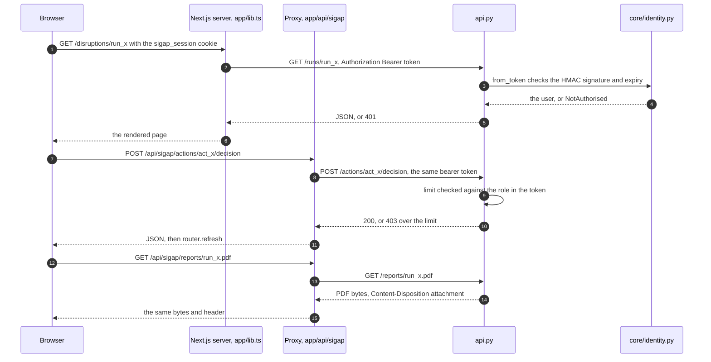

# The web app

> The Next.js app at the repository root: what each page shows, how a page reaches the
> agent service, how a person is signed in, and how a report comes down as a file.
> Paths here are relative to the repository root.

The web app holds no data and makes no decision. Every figure it shows is read from the
agent service (`sigap/agent/api.py`) at the moment the page is rendered, and every button
that changes something is a `POST` to that service. The browser never talks to the agent
service directly: it talks to the Next.js server, which attaches the session token.

| Part | Path | Does |
|---|---|---|
| Pages | `app/(app)/**/page.tsx` | Server components. Read the agent service through `app/lib.ts` while rendering |
| Interactive parts | `app/(app)/**/*.tsx` beside each page (`Decision.tsx`, `Manage.tsx`, `Choose.tsx`, `Jobs.tsx`, `Upload.tsx`, `Conversation.tsx` …) | Client components. Write through the proxy, then `router.refresh()` |
| Server-side client | `app/lib.ts` | `api()` and `apiResult()`: one `fetch` to `SIGAP_API` with the bearer token from the cookie; the shared types (`Run`, `Trace`, `View` …) |
| Proxy | `app/api/sigap/[...path]/route.ts` | Forwards a browser `GET` or `POST` to the agent service with the token attached; passes JSON, event streams and files through untouched |
| Login | `app/api/login/route.ts`, `app/login/page.tsx` | Exchanges email and password for a token and keeps it in an httpOnly cookie; `DELETE` signs out |
| Shell | `app/(app)/layout.tsx`, `components/app-sidebar.tsx` | Sidebar, breadcrumbs, the connection badge, and the redirect to `/login` |
| Shared components | `components/` | Tables, charts, the trace views, `report-files.tsx`, `agent-activity.tsx` (the label shown for every tool) |

`SIGAP_API` names the agent service (default `http://127.0.0.1:8787`). It is read in
three places, `app/lib.ts`, the proxy and the login route, and nowhere in browser code.

---

## Pages

Every page under `app/(app)/` renders inside the shell, and the shell asks `GET /me` and
`GET /health` first. `/login` sits outside the group.

| URL | File | Reads while rendering | Writes from the page |
|---|---|---|---|
| `/` Decision queue | `app/(app)/page.tsx` | `/runs`, `/health` | |
| `/dashboard` | `dashboard/page.tsx` | `/summary`, `/data/inventory`, `/data/sourcing`, `/data/logistics`, `/data/simulation` | |
| `/disruptions/[id]` | `disruptions/[id]/page.tsx` | `/runs/{id}`, `/runs/{id}/graph` | `Decision.tsx`: `POST /actions/{id}/decision`; `Outbound.tsx`: `POST /actions/{id}/resend` |
| `/log` | `log/page.tsx` | `/log`, `/runs` | |
| `/log/[id]` | `log/[id]/page.tsx` | `/runs/{id}/trace` | `components/trace-calls.tsx` reads `/runs/{id}/steps/{seq}` on demand |
| `/reports` | `reports/page.tsx` | `/runs` | file links: `/reports/{id}.pdf`, `.xlsx`, `/portfolio.pdf`, `.xlsx` |
| `/reports/[id]` | `reports/[id]/page.tsx` | `/reports/{id}`, `/runs/{id}` | file links; `POST /reports/{id}/send` |
| `/reports/portfolio` | `reports/portfolio/page.tsx` | `/portfolio` | file links; `POST /portfolio/send` |
| `/agents` | `agents/page.tsx` | `/agents` | |
| `/agents/[code]` | `agents/[code]/page.tsx` | `/agents`, `/data/{code}` | `Conversation.tsx`, `AskDrawer.tsx`: `POST /agents/{code}/ask`, `/agents/{code}/conversations`, `/conversations/{id}`, `POST /conversations/{id}/delete` |
| `/chat` | `chat/page.tsx` | `/agents` | the same `Conversation.tsx` |
| `/audit` | `audit/page.tsx` | `/audit` | the export is built in the browser (`audit/Actions.tsx`) |
| `/uploads` | `uploads/page.tsx` | `/uploads` | `Upload.tsx`: `POST /uploads`; `Delete.tsx`: `POST /uploads/{id}/delete` |
| `/contacts` | `contacts/page.tsx` | `/contacts`, `/notifications` | `Manage.tsx`: `POST /contacts`, `GET /contacts/{id}`, `POST /contacts/{id}` (edit), `POST /contacts/{id}/delete`; `Alerts.tsx`: `POST /notifications/test`, `POST /notifications/connect` |
| `/models` | `models/page.tsx` | `/models` | `Choose.tsx`: `POST /models`, `POST /models/test` |
| `/schedule` | `schedule/page.tsx` | `/schedule` | `Jobs.tsx`: `POST /schedule/{name}/run`, `POST /schedule/{name}/enabled` |
| `/data/[domain]` | `data/[domain]/page.tsx` | | a permanent redirect to `/agents/[domain]` |
| `/login` | `app/login/page.tsx` | | `POST /api/login` |

The page for one agent and the data that agent works with are one page: the domain name
in `/data/{domain}` is the agent's code, and `tools/views.py` keys its views the same way
(`VIEWS`), so a page and its specialist cannot drift apart.

A page whose handling is still running refreshes itself every four seconds while the tab
is visible (`components/auto-refresh.tsx`), which is how the queue, a disruption and its
trace follow the agents without a reload.

### Route map

Pages that follow one handling, and what they read:

The team and settings pages:

---

## How a page reaches the agent service

There are two ways, and both carry the same token.

**While rendering (server components).** A page calls `api<T>(path)` or
`apiResult<T>(path)` from `app/lib.ts`. That runs on the Next.js server: it reads the
`sigap_session` cookie through `next/headers`, calls `${SIGAP_API}/${path}` with
`Authorization: Bearer <token>` and `cache: "no-store"`, and returns the parsed JSON.
`apiResult` also returns an error string (the service's own `error` field, or the HTTP
status, or "not responding at …"), which the page shows instead of an empty table. Every
read is fresh; nothing is cached between requests.

**From a button (client components).** A component calls `fetch("/api/sigap/<path>")`.
The catch-all route `app/api/sigap/[...path]/route.ts` reads the same cookie, attaches the
bearer token, and forwards `GET` or `POST` (with the body as text) to the agent service.
It answers in one of three ways:

- an event stream (`text/event-stream`) is passed through as a stream, which is how an
  agent's reply arrives token by token on the conversation page;
- anything else is passed back as raw bytes (`arrayBuffer()`, never decoded as text),
  keeping `Content-Disposition` when the service set one;
- the agent service not answering becomes a `503` with the command to start it.

---

## Session and authority

| Step | Where | What happens |
|---|---|---|
| Sign in | `app/login/page.tsx` → `POST /api/login` → `POST /login` | `core/identity.log_in` checks the pbkdf2 hash in the `users` table and `issue_token` signs `{sub, email, name, role, exp}` with HMAC-SHA256 under `SIGAP_SECRET` |
| Keep it | `app/api/login/route.ts` | The token goes into the `sigap_session` cookie: httpOnly, `sameSite=lax`, `secure` in production, 12 hours, the same lifetime as `identity.SESSION_HOURS`. No script on the page can read it |
| Use it | `app/lib.ts`, the proxy | Copied into `Authorization: Bearer` on every call |
| Check it | `api._user` → `identity.from_token` | Every route but `/health` and `/login` needs it. The signature and the expiry are checked; the role comes from the token and nothing else |
| No session | `app/(app)/layout.tsx` | When `/health` answers and `/me` does not, the shell redirects to `/login`. When the service is down it stays, and the pages say the service is down |
| Sign out | `components/nav-user.tsx` → `DELETE /api/login` | Deletes the cookie. Tokens are stateless (there is no sessions table), so the token itself stays valid until it expires |

Authority is enforced in `api.py`, not by hiding a button. The pages read `may_change`
from `/notifications`, `/schedule` and `/models` to decide what to show, but the routes
check the role again:

| Role | Approves up to (`identity.ROLE_LIMITS`) | Settings: contacts, models, schedule, test alerts |
|---|---|---|
| `planner` | nothing, read only | no |
| `buyer` | Rp 500 million | no |
| `procurement_lead` | Rp 10 billion | yes |
| `admin` | Rp 10 billion | yes |

An outward message has its own rule on top of the money limit
(`outreach.APPROVERS`): a supplier request needs a buyer or above, a customer notice a
procurement lead or above. `agents.md` and `workers.md` have the rest.

---

## Files: PDF and XLSX

A report comes down as a file the browser saves under the name the service chose.

1. `components/report-files.tsx` renders two plain links,
   `<a href="/api/sigap/<base>.pdf" download>` and `.xlsx`, where `<base>` is
   `reports/<run id>` or `portfolio`. They are used on `/reports`, `/reports/[id]` and
   `/reports/portfolio`.
2. The proxy forwards the `GET` and returns the body as bytes with the service's
   `Content-Type`, `Content-Disposition` and `Cache-Control: no-store`. Decoding a PDF as
   UTF-8 would corrupt it, which is why the proxy never reads it as text.
3. `api.py` routes `/reports/{id}.(pdf|xlsx)` and `/portfolio.(pdf|xlsx)` return a
   `Download`, which `Handler._send_file` writes with
   `Content-Disposition: attachment; filename="…"; filename*=UTF-8''…`.
4. The bytes are made by `engine/report.py` (`run_file`, `portfolio_file`) with the
   standard-library writers in `engine/export.py`. `data.md` has what each file holds.

Two downloads never touch the service: the report's markdown on `/reports/[id]`
(`reports/[id]/Actions.tsx`) and the audit export on `/audit` (`audit/Actions.tsx`) are
built in the browser from what the page already holds, as a `Blob`.

`/reports/[id]` and `/reports/portfolio` also have a send action that posts the
chosen contacts and formats to `POST /reports/{id}/send` or `POST /portfolio/send`, through
the same proxy. The files are then rendered on the server when the email leaves
(`workers.md`, Alerts).

---

## The conversation page

`/agents/[code]` and `/chat` talk to one specialist outside any handling.
`Conversation.tsx` posts `{question, conversation_id?, attachments?}` to
`POST /agents/{code}/ask` with `accept: text/event-stream`. The service runs
`graph.ask_specialist` and streams the agent's progress; the proxy passes the stream
through. If the stream drops, the page polls `GET /conversations/{id}` until the answer is
stored. A conversation belongs to the person who asked (`conversations.user_id`) and is
never listed for anyone else. It opens no run, so a tool that would record an action
refuses (`agents.md`).
