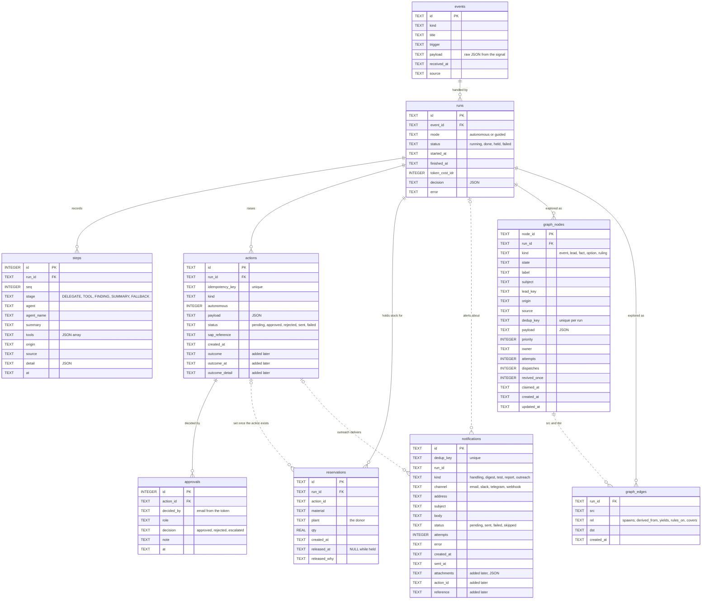
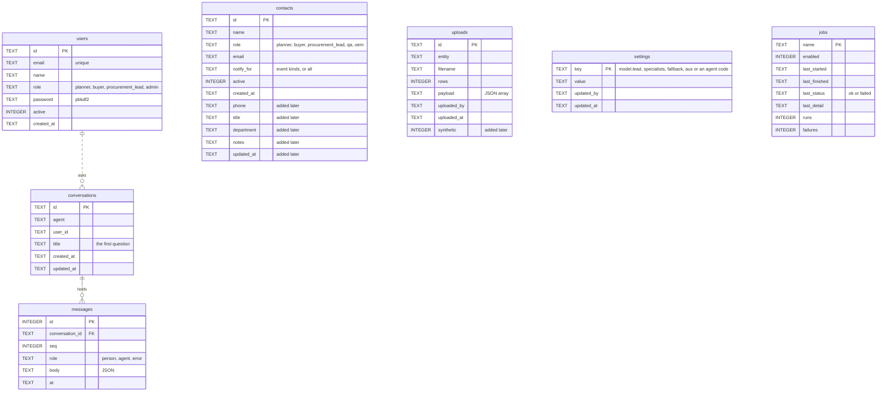
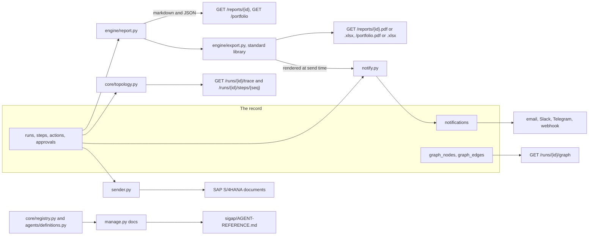

# Data: the record, the fixtures, and what comes out

> The SQLite database table by table, who writes each and who reads it; the fixture data
> SIGAP runs on before it has SAP; and every output the system produces from the record.
> Paths are relative to `sigap/agent/`.

---

## The database

One SQLite file, `SIGAP_DB` (default `data/sigap.db` under `sigap/agent/`), opened only by
the agent service and its command-line tools. `core/store.connect()` turns on foreign keys
and WAL, applies `SCHEMA` on every connect (`CREATE TABLE IF NOT EXISTS`), then adds each
column in `ADDED_LATER` to a database that predates it; the "duplicate column" error is the
normal outcome. The `users` table is created the same way by `core/identity.py`.

What lands here is the official record: what the agents decided, on what evidence, who
approved it, and what was actually sent. A row in `approvals` is never changed, and an
`actions` row changes only in its status, its SAP reference and its outcome, each moving one
way: a decision applies only to a `pending` action, `mark_sent` only to an `approved` one,
and an outcome is recorded once. A correction is a new row.

There is no sessions table: a session is a signed token (`app.md`).

### The handling record

Solid lines are declared foreign keys. Dotted lines are references the code keeps without
a declared key: `reservations.action_id`, `notifications.run_id`, `notifications.action_id`,
and an edge's `src` and `dst`, which name `graph_nodes.node_id`.

### People, conversations and settings

`approvals.decided_by` and `uploads.uploaded_by` hold the email from the session token;
`conversations.user_id` holds the user's id. None is a declared key.

### Table by table

| Table | Holds | Written by | Read by |
|---|---|---|---|
| `events` | One disruption signal as it arrived | `store.record_event` from `api.raise_event` (`POST /events`, the four watcher jobs), `manage.py seed` | runs joins, `detect_disruption`, `store.event_exists` (the watchers' dedup), `past_incidents` |
| `runs` | One handling: mode, status, timing, model spend, the decision as JSON (`recommendation`, `agents_called`, `cost_by_model`, `untrusted_on_board`, `graph`, and `status` and `reason` when stopped short or held) | `store.start_run` and `store.close_run` from `api.raise_event` (closed `held` at once when no model can be called) and `api._handle` (`done` or `failed`) | `/runs`, `/runs/{id}`, `/summary`, reports, `notify`, Otto, the trace |
| `steps` | Every delegation, tool call (arguments, full result, origin, source, ms, rows), finding and summary, in order | the `report` callback in `api._handle` (`store.save_step`) | `/log`, `/runs/{id}`, `core/topology.py`, the report's Steps sheet and its per-tool sheets |
| `actions` | What the team proposed or did, keyed by content | `tools/execution.raise_action` (Bram's tools, Prita's `propose_purchase_order`); `decide_action` (status), `mark_sent` (status and SAP reference, from `sender.py` or outreach), `record_outcome` (outcome, once) | the decision queue, `sender.py`, `notify`, the digest, reports, `/summary`, Otto |
| `approvals` | Each decision on an action: who, in what role, approved, rejected or escalated, with a note | `store.decide_action` from `POST /actions/{id}/decision` | `/runs/{id}`, `/log`, reports |
| `reservations` | Stock held at a donor plant by a proposed transfer, so a second handling running at the same time cannot promise it too | `store.reserve` from `create_stock_transfer`; released by a rejection, an outcome, or the run closing `failed` or `held` | `assess_transfer` (`reserved_qty`, its own run excluded) |
| `notifications` | The outbox: one message to one address over one channel, and whether it arrived | `notify.queue_handling`, `queue_digest`, `queue_test`, `queue_report`, `outreach.queue`; `mark_notification` after each attempt | `notify.deliver`, `GET /notifications`, `outreach.state` |
| `jobs` | The schedule's memory: switched on or off, last start and finish, last result, counts | `core/schedule.py` (`job_started`, `job_finished`), `POST /schedule/{name}/enabled` | `core/schedule.py`, `GET /schedule` |
| `graph_nodes`, `graph_edges` | The exploration graph of one handling, with `SIGAP_GRAPH=1` | `core/exploration.py` through the mirror in `graph.py` and `engine/planner.py`, `engine/dispatch.py` | `GET /runs/{id}/graph`, the dispatcher, the planner |
| `users` | Who may sign in, with a pbkdf2 password hash and a role | `manage.py user` (`identity.add_user`) | `identity.log_in` |
| `conversations`, `messages` | A person's conversation with one agent, never shown to anyone else | `POST /agents/{code}/ask`; `POST /conversations/{id}/delete` removes one with its messages | `/agents/{code}/conversations`, `/conversations/{id}` |
| `contacts` | Who is told: name, role, email, which event kinds (`*` for all), and contact details that are shown, never sent | `POST /contacts`, `POST /contacts/{id}`; a delete sets `active=0` | `notify` recipients, report sends, `/contacts` |
| `uploads` | A company CSV in place of SAP, as JSON rows, with whether the uploader declared it generated | `POST /uploads` after `core/schema.validate` | `tools/fetcher.py` (latest upload per entity) |
| `settings` | Model choices from the Models page, `model.<lead, specialists, fallback, aux or agent code>`; an absent key hands the choice back to the environment | `POST /models` (`store.save_model_choices`) | `api._load_model_choices` → `core/llm.choose` |

---

## Fixture data

Before an SAP key is in place, SIGAP runs on a dataset nobody should mistake for real.
Every row read from it is labelled `modelled` (`tools.md`, Origins).

| File | What it is |
|---|---|
| `fixtures/generate.py` | Builds the dataset deterministically (seed `20260929`, as of 4 September 2026) for an invented Tier-1 automotive supplier, and plants known master-data defects (`DEFECTS`) that `engine/audit.py` must find. `--check` rebuilds and confirms it is stable |
| `fixtures/ningbo_scenario.json` | The JSON fixture the tools read: `MaterialStock`, `PurchaseOrder`, `BillOfMaterial`, `SalesOrder`, `AlternateSource` (the five options A to E of `../DESIGN.md` §1.7 and more), `Supplier`, `Quotation`, `CustomsDeclaration`, `MaterialSubstitute`, `PartnerContact` (every address ends in `.example`), and `Profile`, the company profile |
| `fixtures/consumption_history.json` | Daily withdrawals per material and plant, kept apart because only the forecaster reads it: `forecast_demand` (`tools/demand.py`) when SAP is not connected |
| `fixtures/demo/*.csv` | The same entities as CSV, one file each, ready to upload on the Uploads page to see the `cached` path. `ConsumptionHistory.csv` is written beside them, but the Uploads page refuses it: `core/schema.py` has no such entity |
| `fixtures/README.md` | The warning that none of it is real |

The company profile (`Profile`: plants, facilities with coordinates, TKDN position and
floor, as-of date) is the one modelled thing by design: it stands in for a customer's own
master data until there is a customer (`../DESIGN.md` §1.1). `signals/places.py` measures
every outside signal against its facilities and against the loading ports of the open
orders.

An upload replaces the fixture for one entity. `core/schema.py` lists the entities and the
columns each must carry (`GET /uploads/template/{entity}` returns them with a sample row):
the seven SIGAP reads from SAP when connected (the six in `tools/fetcher.ENTITIES` and the
bill of materials), plus `CustomsDeclaration` and `MaterialSubstitute`, which no SAP service
supplies, and `PartnerContact`, the addresses an outward message falls back to when the
business partner in SAP carries no email (`tools/execution.partner_address`).

---

## What comes out

### Reports

`engine/report.py` assembles a handling, or every handling at once, from the database.
The figures are deterministic. The only text a model writes is an optional executive
summary from the aux model (`core/aux.py`), handed the figures as facts and told not to
introduce a number; without the aux model the summary is left out and the report stands.

| Output | Built by | Holds |
|---|---|---|
| `GET /reports/{id}` | `build_report` | the report as markdown, the summary, and the list of sheets the workbook will hold |
| `GET /reports/{id}.pdf` | `run_file` → `run_pdf` | the handling written up: decision, actions with their money and status, approvals, the steps, provenance |
| `GET /reports/{id}.xlsx` | `run_file` → `run_sheets` | Summary, Actions (every payload field as a column, SAP reference, outcome, actual cost), Approvals, Steps, each markdown table in the recommendation, and one sheet per tool with the rows it returned |
| `GET /portfolio` | `build_portfolio` | every handling rolled up: counts by status and kind, decided on trusted evidence or with a caveat, actions raised, sent and waiting, predicted against actual on settled actions |
| `GET /portfolio.pdf`, `.xlsx` | `portfolio_file` | the same, with sheets Summary, Handlings, Actions |
| emailed | `notify.files_for` | the same files, rendered when the message leaves: a handling alert's PDF (`SIGAP_ALERT_ATTACH`), a report sent from the Reports pages |

A handling's files are named `sigap-<title slug>-<last six of the run id>.pdf` or `.xlsx`;
the portfolio's `sigap-operations-report-<date>`.
`engine/export.py` writes both formats with the Python standard library alone: XLSX as
zipped SpreadsheetML, PDF with the built-in Helvetica and Courier metrics.

### The trace

`core/topology.build(run)` folds a run's steps into a graph, and writes nothing:

| Nodes | Edges |
|---|---|
| `event`, `agent` (the lead and each specialist), `tool` (one per agent and tool), `source` (an SAP service, an upload, a fixture, a feed), `action` | `triggers` (event to lead), `delegates` (lead to specialist), `calls` (agent to tool), `reads` (tool to source), `raises` (tool to action) |

Nodes are aggregated, so a tool called nine times is one node; each edge carries its count,
the step numbers behind it, and the weakest origin among its calls. Beside the graph the
calls stay in order, each with its arguments, provenance and a preview of its result (25
rows, 6000 characters); `GET /runs/{id}/steps/{seq}` returns one step in full. The web app
draws it on `/log/[id]` (`components/trace-topology.tsx`, `trace-calls.tsx`).

`GET /runs/{id}/graph` is the other picture of the same handling: the exploration graph
when `SIGAP_GRAPH=1` was on (`agents.md`), shown on `/disruptions/[id]`
(`components/exploration-graph.tsx`), empty otherwise.

### Alert messages

Each `notifications` row is the message as sent: subject, body, channel, address, status,
attempts, the last error, the files it names and the mail server's
message id. A handling alert says, from the tables: the status; the lead's recommendation
quoted and labelled as the lead's; what was carried out or approved, with its SAP
reference or "not posted to SAP"; what waits for approval, its value and the lowest role
that may approve it; what Bram's `notify` asked to tell a role; a warning when evidence
was modelled or missing; and the link to the handling. A handling that recorded no action
says so, whatever its prose claims. `workers.md` has the kinds and the rules.

### SAP writes

| Write | When | Service |
|---|---|---|
| Stock transfer | at once, from `create_stock_transfer` through `sender.send_one`, when autonomous; a write that fails, or SAP not yet connected, leaves it `approved` for the `sap_send` job | `API_STOCK_TRANSFER_SRV` `A_StockTransfer` |
| Approved actions | the `sap_send` job (`sender.TARGETS`) | `draft_po` → `API_PURCHASEREQ_PROCESS_SRV` `A_PurchaseRequisitionHeader`; `stock_transfer` → `API_STOCK_TRANSFER_SRV` `A_StockTransfer`; `create_sourcing_event` → `API_SOURCING_PROJECT_SRV` `A_SourcingProject` |

Each write carries the action's idempotency key. The reference SAP returns
(`PurchaseRequisition`, `MaterialDocument`, or `sent`) is stored as `actions.sap_reference`.
An outward email delivered by outreach stores `email <message id>` there
instead. The write-side entity names are not yet verified against the sandbox
(`../DATA-SOURCES.md` §1).

### Generated documentation

`python3 manage.py docs` regenerates `../AGENT-REFERENCE.md` from the live registry and
`agents/definitions.py`: each agent, its effort and veto, every tool with its parameters
and description, and the approval limits from `core/identity.py`. It is never edited by
hand; a tool description changed in code is stale there until the command is run again.

`python3 main.py --out <file>` writes a scripted trace of the Ningbo scenario as JSON
(`core/trace.py`). It is a walkthrough of the design, not a record, and no page reads it.
