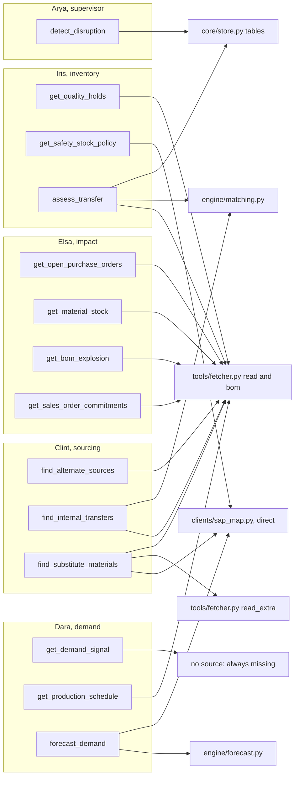
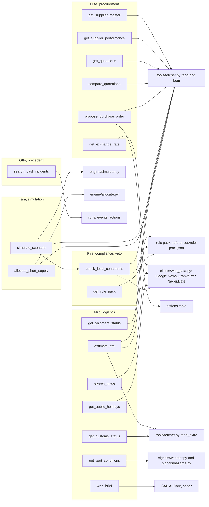
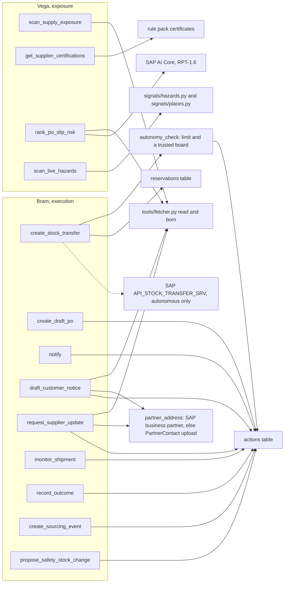
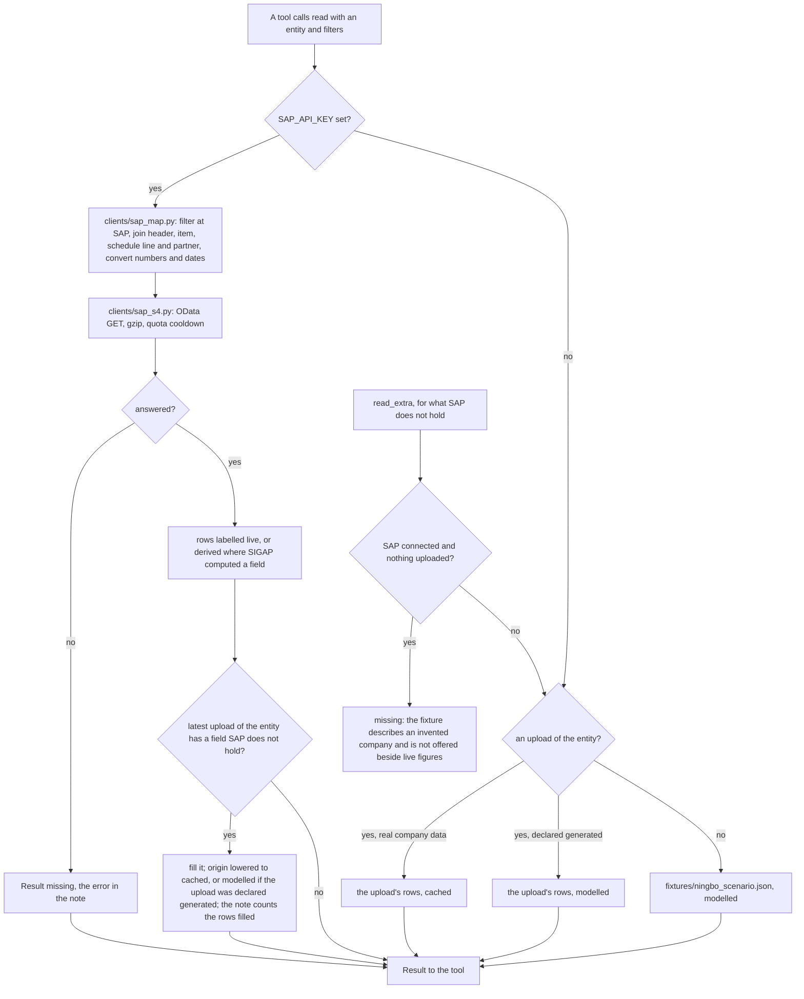

# Tools and the data path

> The tool registry, all 46 tools by the agent that owns them, the path every read takes
> to SAP, an upload or the fixture, the origin label every result carries, the
> deterministic engines that do the arithmetic, and the rule pack Kira rules from.
> Paths are relative to `sigap/agent/`.

---

## The registry

`core/registry.py` holds one `Tool` per name: its owner (an agent code), its description,
its JSON schema and the function that runs. A tool registers itself with a decorator:

```python
@register("get_material_stock", "impact",
          "Material stock per plant together with its daily consumption rate.",
          {"material": {"type": "string"}, "plant": {"type": "string"}})
def get_material_stock(material=None, plant=None) -> Result: ...
```

| Rule | Where |
|---|---|
| The schema the model sees is the schema that runs: `schemas_for_model(code)` sends each tool's `input_schema` verbatim, with `strict: true` and `additionalProperties: false` | `core/registry.py` |
| Importing the `tools` package registers every tool. One file per agent, named after its code (`impact.py` holds Elsa's, `compliance.py` Kira's) | `tools/__init__.py` |
| An argument named `material`, `plant`, `from_plant` or `to_plant` is checked before the tool runs, on a copy: an id on record passes, a phrase that names exactly one id is read as that id, anything else raises `ValueError` back to the model. An empty list for a material that does not exist reads like "nothing found", which is the wrong answer stated with confidence | `tools/__init__.py`, `tools/fetcher.material_id`, `plant_id` |
| The run and the board in force reach a tool through context variables (`bind_run`, `bind_board`), because the schema has no spare parameter to carry them | `core/registry.current_run`, `current_board` |
| Every tool returns a `Result`, never a bare value | `core/provenance.py` |
| What the agents claim and what is registered are the same set, both ways | `agents/definitions.py demo()` |

The same registry is served three more ways: `POST /mcp` (`mcp.py`) for AgentCore
Gateway and SAP Joule, `GET /exposure` and the `exposure` job (Vega's tools without a
model), and `tools/views.py`, which arranges existing tools into the tables on each
agent's page (`GET /data/{code}`). `manage.py docs` writes `../AGENT-REFERENCE.md` from
it, with every parameter.

---

## The 46 tools, by owner

"Reads" names the path in the next section: `read(Entity)` and `bom()` go through
`tools/fetcher.py` to SAP, an upload or the fixture; `read_extra(Entity)` is for what SAP
does not hold.

| Agent | Tool | Reads | Computes or writes |
|---|---|---|---|
| Arya | `detect_disruption` | the `events` table | |
| Elsa | `get_open_purchase_orders` | `read(PurchaseOrder)` by port, material or supplier; `read(Supplier)` | |
| Elsa | `get_material_stock` | `read(MaterialStock)` | |
| Elsa | `get_bom_explosion` | `bom()` | |
| Elsa | `get_sales_order_commitments` | `read(SalesOrder)` by finished good | |
| Dara | `get_demand_signal` | nothing is connected; always `missing` ("SAP IBP demand plan") | |
| Dara | `get_production_schedule` | `read(MaterialStock)` for the daily rate | |
| Dara | `forecast_demand` | 90 days of goods issues (`sap_map.consumption_series`), else `fixtures/consumption_history.json` | `engine/forecast.py` |
| Iris | `get_quality_holds` | `read(MaterialStock)`: stock types 02 and 07 and special stock | |
| Iris | `get_safety_stock_policy` | `sap_map.safety_stock` (`API_PRODUCT_SRV`), `missing` without SAP | |
| Iris | `assess_transfer` | `read(MaterialStock)`, open `reservations` | `engine/matching.assess` |
| Clint | `find_alternate_sources` | `read(AlternateSource)` | |
| Clint | `find_internal_transfers` | `read(MaterialStock)` | `engine/matching.find` |
| Clint | `find_substitute_materials` | `sap_map.bom_alternatives`, `read_extra(MaterialSubstitute)`, `read(MaterialStock)` | |
| Prita | `get_supplier_master` | `read(Supplier)`, `read(PurchaseOrder)` | volume shares, duplicate suppliers |
| Prita | `get_supplier_performance` | `read(PurchaseOrder)` including delivered lines | slip per supplier |
| Prita | `get_quotations` | `read(Quotation)` | |
| Prita | `compare_quotations` | `read(Quotation)`, `read(Supplier)` | ranking by total cost, validity on the as-of date |
| Prita | `propose_purchase_order` | `read(Quotation)` | a `draft_po` action, always pending |
| Prita | `get_exchange_rate` | Frankfurter, ECB reference rates (`clients/web_data.py`) | |
| Milo | `get_shipment_status` | `read(PurchaseOrder)` | |
| Milo | `estimate_eta` | `read(AlternateSource)`, `read_extra(CustomsDeclaration)`, the rule pack's default dwell | median and 80th percentile dwell |
| Milo | `get_customs_status` | `read_extra(CustomsDeclaration)` | |
| Milo | `get_port_conditions` | Open-Meteo forecast and marine, GDACS, EONET, USGS (`signals/weather.port_conditions`) | threshold flags |
| Milo | `search_news` | Google News RSS, headlines only | |
| Milo | `get_public_holidays` | Nager.Date | |
| Milo | `web_brief` | `sonar` on SAP AI Core, with the pages it read | labelled `derived` |
| Kira | `check_local_constraints` | `read(AlternateSource)`, the rule pack, the company profile, Nager.Date for working days | allowed or blocked, with the rule and the numbers |
| Kira | `get_rule_pack` | the rule pack | |
| Tara | `simulate_scenario` | Elsa's stock, Clint's options, `read(PurchaseOrder)` for arrivals, Kira's rulings | `engine/simulate.py` |
| Tara | `allocate_short_supply` | `bom()`, `read(SalesOrder)`, `read(MaterialStock)` | `engine/allocate.py` |
| Otto | `search_past_incidents` | `runs`, `events`, and the outcomes on `actions` (`store.past_incidents`) | |
| Bram | `create_stock_transfer` | the board, for `autonomy_check` | a `stock_transfer` action and a `reservations` hold; when autonomous it starts `approved` and goes to SAP at once through `sender.send_one` |
| Bram | `create_draft_po` | | a `draft_po` action, always pending |
| Bram | `notify` | | a `notify` action, quoted in the handling's alert |
| Bram | `draft_customer_notice` | `read(SalesOrder)`, the customer's email | a `customer_notice` action, always pending |
| Bram | `request_supplier_update` | `read(PurchaseOrder)`, the supplier's email | a `supplier_request` action, always pending |
| Bram | `monitor_shipment` | | a `monitor` action |
| Bram | `record_outcome` | | `actions.outcome`, written once |
| Bram | `create_sourcing_event` | | a `create_sourcing_event` action, always pending |
| Bram | `propose_safety_stock_change` | | a `propose_safety_stock_change` action, always pending, never sent to SAP |
| Vega | `scan_supply_exposure` | `read(MaterialStock)`, `read(PurchaseOrder)`, `bom()`, `read(SalesOrder)`, `read(AlternateSource)` | single sources, concentrated lanes, cover below policy |
| Vega | `get_supplier_certifications` | the rule pack's `certificates` | days to lapse |
| Vega | `rank_po_slip_risk` | `read(PurchaseOrder)` | SAP RPT-1.6 on AI Core predicts slip; labelled `modelled` |
| Vega | `scan_live_hazards` | GDACS, EONET, USGS against `signals/places.watched()` | distance against radius |

The customer's or supplier's email comes from
`tools/execution.partner_address`: the business partner's address in SAP
(`sap_map.partner_email`, `API_BUSINESS_PARTNER` `A_BusinessPartnerAddress` →
`to_EmailAddress`, the default address first), else an uploaded `PartnerContact` row
through `read_extra`, else `missing`. Never an address the model wrote. The address, its
source and its origin travel in the action's payload with the subject and body, so what
a person approves is the message as it will be sent.

### Agent to tools, with what backs each

The lead and the agents that work out what is hit:



The agents that find, judge and cost the way out:



The agents that act, and the one that looks ahead:



`monitor_shipment` records a `monitor` action and nothing more: no job follows the
shipment afterwards. The outcome is closed by `record_outcome` or
`POST /actions/{id}/outcome`.

---

## The data path every read takes

Every tool reads company data through `tools/fetcher.py`, and the fall-back is never
hidden: it shows in the origin label.

| Function | Use |
|---|---|
| `read(entity, material=, plant=, port=, materials=, numbers=, ids=, supplier=, open_only=)` | The six SAP entities below, filtered |
| `bom()` | The bill of materials, as flat `Material → FinishedGood` rows |
| `read_extra(entity, keep)` | An entity S/4HANA does not hold: `CustomsDeclaration` (customs lives in CEISA), `MaterialSubstitute` (engineering's approvals), `PartnerContact` |
| `profile()`, `fixture(entity)` | The company profile and the raw fixture. The profile is the one modelled thing by design (`../DESIGN.md` §1.1) |
| `current_dataset()` | Every entity by the same path, with where each came from; what `GET /audit` reads |



The six SAP entities, the service each is read from, and the fields SAP does not hold
(`fetcher.ENTITIES`, `fetcher.SUPPLEMENT`, `clients/sap_map.py`):

| Entity | Read from | Not in SAP, filled from an upload when there is one |
|---|---|---|
| `MaterialStock` | `API_MATERIAL_STOCK_SRV` `A_MatlStkInAcctMod`, by stock type | `DailyConsumption` is derived from 90 days of goods issues in `API_MATERIAL_DOCUMENT_SRV`, which labels the result `derived`; an upload fills it otherwise |
| `PurchaseOrder` | `API_PURCHASEORDER_PROCESS_SRV` `A_PurchaseOrderItem` with its header and schedule lines | `LoadingPort`, derived from the incoterms location when it names a port |
| `SalesOrder` | `API_SALES_ORDER_SRV` `A_SalesOrderItem` with its header, customer names | `LatePenaltyPctPerDay`, `LatePenaltyCapPct` (contract terms) |
| `Supplier` | `API_BUSINESS_PARTNER` `A_Supplier`, country from `A_BusinessPartnerAddress` | `TkdnCertifiedPct` |
| `AlternateSource` | `API_INFORECORD_PROCESS_SRV` `A_PurchasingInfoRecord` | `Quantity`, `ExtraCostIDR`, `TkdnAfterPct`, `NewOrigin` |
| `Quotation` | `API_QTN_PROCESS_SRV` `A_SupplierQuotationItem` | |
| bill of materials (`bom()`) | `API_BILL_OF_MATERIAL_SRV` `A_BillOfMaterial` + `A_BillOfMaterialItem` | |

Direct reads outside `read()`: `sap_map.safety_stock` (`API_PRODUCT_SRV`
`A_ProductSupplyPlanning`), `sap_map.bom_alternatives`, `sap_map.consumption_series`,
`sap_map.partner_email`, `sap_map.material_exists` (an id the capped id lists missed is
asked about before it is refused).

What keeps the reads honest and cheap:

| Rule | Where |
|---|---|
| Filter at SAP: a material or plant goes into `$filter`, never into a Python filter over a capped page | `clients/sap_map.py` |
| A read is capped at `SIGAP_SAP_ROWS` (default 2000) and a capped read says so in its note | `clients/sap_map.py` |
| One handling reads the same rows many times, so `sap_map` keeps them 120 s; the list of known ids is kept five minutes | `sap_map.TTL_SECONDS`, `fetcher._known` |
| After a rate-quota answer SAP is not called again for `SAP_QUOTA_COOLDOWN` seconds (default 300); each call would only count against the quota | `clients/sap_s4.py` |
| No key raises `MissingApiKey`; the caller turns it into `missing`. The client never invents a row | `clients/sap_s4.py` |
| An upload is validated against `core/schema.py` before it is kept; a file that fails is refused with the rows at fault | `POST /uploads` |

The one write path to SAP is `clients/sap_s4.post`: it fetches a CSRF token and its
cookie first, then posts with `Idempotency-Key`. It is called only by `sender.py`: on the
`sap_send` job for approved actions, and at once (`send_one`) when `create_stock_transfer`
raises an autonomous one (`workers.md`).

---

## Origins

`core/provenance.py` is short and everything else leans on it.

| Origin | Means | Arises from |
|---|---|---|
| `live` | straight from SAP or an official API | an SAP read, a public feed, the event record |
| `cached` | was live once, carries its timestamp | an upload of the company's real data; an SAP row filled from such an upload |
| `derived` | computed from something live | the engines; an action record; consumption derived from goods issues; a rule from a pack entry with a source and `"verified": true`; a hazard measured against the places; the `sonar` answer |
| `modelled` | company profile or fixture, labelled in the open | the fixture; an upload declared generated; a built-in rule; a pack entry not verified; the RPT-1.6 slip ranking |
| `missing` | the lead stops here rather than guessing | any failure, any source not connected, an entity never uploaded |

- `TRUSTED = {live, cached, derived}`: only these may back a rupiah figure shown to a
  person.
- `weakest(*origins)` orders `missing < modelled < cached < derived < live` and returns the
  lowest: a finding is never more trustworthy than the weakest thing it rests on. Kira's
  ruling is the weakest of its option, each rule and the calendar; a trace edge is the
  weakest of its calls (`core/topology.py`).
- A `Result` carries `value`, `origin`, `source`, `fetched_at`, `note`; `brief()` is what
  travels to the model beside the value.

Where the label is acted on, not just shown:

| Consumer | Does |
|---|---|
| `engine/simulate.simulate_scenario` | refuses to emit a figure when the stock or the options are not trusted |
| `tools/execution.autonomy_check` | sends an action to a person when anything under it is `modelled` or `missing` |
| `graph.Board.untrusted_keys` | becomes `untrusted_on_board` on the decision, a warning line in the alert, "Not yet trustworthy" in the report |
| `mcp.py` | returns a `missing` result as an MCP error, not as a value |
| `tools/fetcher._supplement` | lowers a live result to the upload's origin when it fills a field from it |

---

## The engines

Everything that produces a number is pure Python under `engine/`. No model is called in
any of them.

| File | Does | Called by |
|---|---|---|
| `engine/simulate.py` | The calculator: cover per day, every option that cleared the rules and their combinations, cost, stockout date, OTIF, TKDN after; `compliance_cost`. Refuses on untrusted inputs. Reproduces `../DESIGN.md` §2 | `simulate_scenario`, `tools/views.py`, `main.py` |
| `engine/allocate.py` | Short supply to customer orders: the costliest lateness per unit served first, set against due-date order | `allocate_short_supply` |
| `engine/forecast.py` | Holt's linear trend over a deseasonalised series, weekly indices, a prediction interval; refuses under 28 days of history | `forecast_demand` |
| `engine/matching.py` | An internal transfer judged from both ends: does the donor keep its own floor, and when would it empty | `assess_transfer`, `find_internal_transfers`, `tools/views.py` |
| `engine/audit.py` | The data audit: integrity, continuity, concentration, compliance, capital; every finding with the rows it rests on | `GET /audit` |
| `engine/planner.py` | The deterministic planner of the exploration graph | `graph.py` mirror, `engine/dispatch.py` |
| `engine/dispatch.py` | The async dispatcher (`agents.md`) | `graph.run` |
| `engine/report.py`, `engine/export.py` | A handling or the portfolio as markdown, PDF and XLSX, on the standard library (`data.md`) | the report routes, `notify.files_for` |

---

## The rule pack

Kira rules from a file the company writes and signs off, not from a model's memory. The
format is `../references/README.md`, an example is `../references/rule-pack.example.json`,
and the pack itself (contract terms, supplier certificates) is installed per deployment
and never committed.

| Piece | Where |
|---|---|
| Path | `SIGAP_RULE_PACK`, else `sigap/references/rule-pack.json` (`core/config.py`) |
| Loading | `tools/compliance.load_pack`: absent is a normal state; a file that does not parse raises, so a ruling fails out loud |
| One rule | `tools/compliance.rule(name)`: the pack's entry where it states one, else the company profile (`tkdn_contract_floor_pct`, `tkdn_current_pct`), else `BUILT_IN` (`lartas_new_origin_working_days` 10, `default_port_dwell_days` 4) |
| Its origin | `derived` only with a `source` and `"verified": true`; anything else `modelled` |
| Holidays | Indonesian public holidays from Nager.Date, live, plus the pack's `collective_leave` (cuti bersama), which no public calendar carries |
| Certificates | the pack's `certificates`, read by Vega's `get_supplier_certifications` |
| Readers | `check_local_constraints`, `get_rule_pack`, `estimate_eta` (default dwell when no customs history), `get_supplier_certifications` |

No pack installed: every ruling rests on the profile and the built-in assumptions and is
labelled `modelled`. The calculator does not refuse on that (its trust check covers the
stock and the options), but the ruling sits on the board as untrusted, so nothing it
leads to goes ahead without a person.
