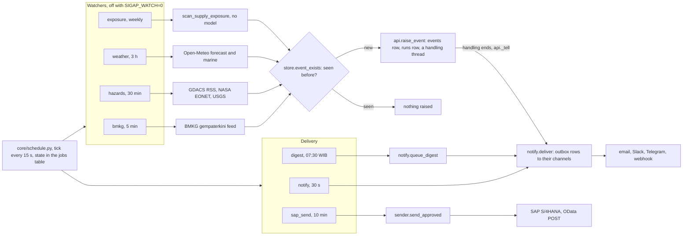
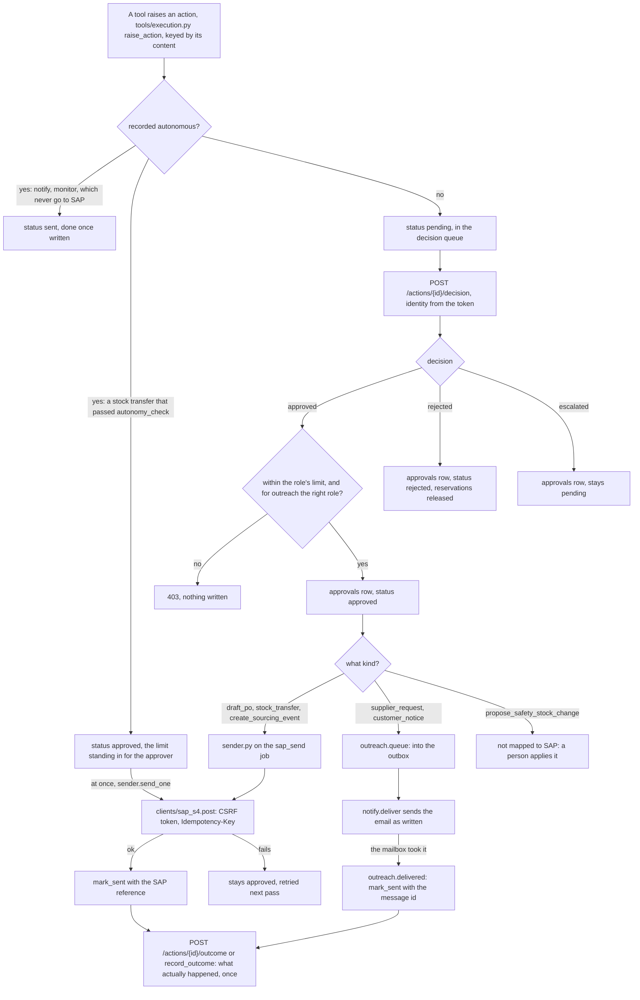
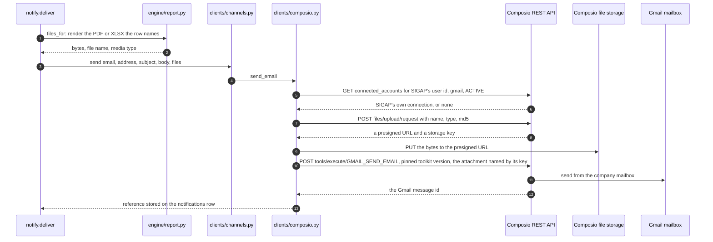

# Workers: what runs without a person

> The HTTP service, the schedule and its seven jobs, the signal watchers that raise
> events, the sender that pushes approved actions into SAP, and the outbox that tells
> people. All of it lives in one Python process. Paths are relative to `sigap/agent/`.

| File | Does |
|---|---|
| `api.py` | The HTTP service, the handling threads, and the process that starts the schedule |
| `core/schedule.py` | The one loop that runs jobs: cadence, no overlap, state in the `jobs` table |
| `jobs.py` | The seven jobs, with their cadences and why |
| `signals/bmkg.py`, `signals/hazards.py`, `signals/weather.py`, `signals/watch.py`, `signals/places.py` | The watchers, and the places they measure against |
| `clients/feeds.py` | One GET for every public feed: a named User-Agent, a timeout, a cache that keeps the real fetch time, a memory of failures |
| `sender.py` | Approved actions into SAP |
| `notify.py` | The alert outbox: what to say, to whom, and delivery with retries |
| `clients/channels.py`, `clients/composio.py` | Email by SMTP or by Composio's Gmail, Slack, Telegram, a webhook |
| `outreach.py` | Approved messages to suppliers and customers, into the same outbox |

---

## The HTTP service

`python3 api.py` loads the model choices saved on the Models page (`_load_model_choices`,
from `settings`), binds the server, builds the schedule from `jobs.py`, starts it, and
serves.

| Piece | Detail |
|---|---|
| Server | `http.server.ThreadingHTTPServer`, one thread per request, routes matched by regular expression from the `@route` table |
| Bind | `core/config.bind_target`: `127.0.0.1:8787` on a machine with no `PORT`; all interfaces when the platform sets `PORT` (Cloud Foundry, `manifest.yml`); `SIGAP_HOST` overrides both. The server binds before the watchers start, so a second copy that cannot take the port raises no events |
| Auth | Every route but `GET /health` and `POST /login` calls `_user(headers)`, which accepts only a bearer token `core/identity.from_token` can verify. A refused token is a `401` |
| Settings routes | Contacts, models, schedule switches, test alerts and the mailbox link need `admin` or `procurement_lead` (`SETTINGS_ROLES`) |
| Answers | JSON; a `Download` (a report file with `Content-Disposition`); or an iterator, sent as `text/event-stream` (the conversation route) |
| Handlings | `raise_event` starts `_handle` on a daemon thread per event, so a handling never blocks a request. `agents.md` has the inside |
| Production gate | With `SIGAP_ENV=prod`, `core/config.load()` refuses to start without `SAP_API_KEY` and a lead model it can call, and `POST /events` answers `503` while either is missing |

The routes, by what they serve:

| Group | Routes |
|---|---|
| Health and identity | `GET /health`, `POST /login`, `GET /me` |
| Handlings | `POST /events`, `GET /runs`, `GET /runs/{id}`, `GET /runs/{id}/trace`, `GET /runs/{id}/steps/{seq}`, `GET /runs/{id}/graph`, `GET /log`, `GET /summary` |
| Decisions | `POST /actions/{id}/decision`, `POST /actions/{id}/outcome`, `POST /actions/{id}/resend` |
| Agents | `GET /agents`, `POST /agents/{code}/ask`, `GET /agents/{code}/conversations`, `GET /conversations/{id}`, `POST /conversations/{id}/delete`, `POST /mcp`, `GET /exposure` |
| Data | `GET /data/{domain}`, `GET /audit`, `GET /uploads`, `POST /uploads`, `GET /uploads/template/{entity}`, `POST /uploads/{id}/delete` |
| Reports | `GET /reports/{id}`, `GET /reports/{id}.pdf` and `.xlsx`, `GET /portfolio`, `GET /portfolio.pdf` and `.xlsx`, `POST /reports/{id}/send` and `POST /portfolio/send` |
| Settings | `GET /contacts`, `POST /contacts`, `GET /contacts/{id}`, `POST /contacts/{id}` (edit), `POST /contacts/{id}/delete`, `GET /notifications`, `POST /notifications/test`, `POST /notifications/connect`, `GET /models`, `POST /models`, `POST /models/test`, `GET /schedule`, `POST /schedule/{name}/run`, `POST /schedule/{name}/enabled` |

---

## The schedule

`core/schedule.Scheduler` is one loop on a background thread that wakes every 15 seconds
(`TICK_SECONDS`) and starts whatever is due. A job runs either `every` N seconds or `at`
a time of day in WIB (UTC+7, no daylight saving).

| Rule | Why |
|---|---|
| A job never overlaps itself | a slow feed on a short interval would otherwise stack threads |
| A job's next run is worked out from when it last started, kept in the `jobs` table | a restart does not re-run a weekly scan that ran yesterday, and does not forget one that failed |
| A daily job missed by more than two hours (`GRACE`) is skipped, not caught up | a 07:30 digest that arrives in the afternoon is noise |
| A job that raises loses that round, not the schedule; the error is kept on the job | the Schedule page shows it |
| `SIGAP_SCHEDULE=0` | nothing runs on its own; a run by hand still works |
| `SIGAP_WATCH=0` | the four jobs that watch the outside world stay off; the outbox and the sender still run |
| `POST /schedule/{name}/enabled` | switches one job, stored in `jobs.enabled` |
| `POST /schedule/{name}/run` | runs one now (`run_now`), refused while it is already running |

The seven jobs (`jobs.all_jobs`):

| Job | Cadence | Calls | Effect |
|---|---|---|---|
| `bmkg` | 5 min | `signals/watch.sweep` → `signals/bmkg.poll` | a quake of M5.0 or more within 300 km of a facility in the company profile becomes a `seismic` event |
| `hazards` | 30 min | `signals/hazards.sweep` | a cyclone, flood, quake, eruption, fire or drought within its radius of a plant or loading port becomes an event (`tropical_cyclone`, `flood`, `earthquake`, `volcano`, `wildfire`, `drought`) |
| `weather` | 3 h | `signals/weather.sweep` | a forecast day over a threshold at a port or plant becomes a `port_weather` or `plant_weather` event, one per spell |
| `exposure` | weekly | `signals/watch.sweep_exposure` → `scan_supply_exposure` | the three most valuable findings become `exposure` events; the same standing risk is quiet for 30 days |
| `notify` | 30 s | `outreach.queue_approved`, then `notify.deliver` | sends what is queued in the outbox |
| `sap_send` | 10 min | `sender.send_approved` | approved actions posted to SAP; skipped with a note when SAP is not connected |
| `digest` | daily 07:30 WIB | `notify.queue_digest`, then deliver | the morning summary to contacts whose `notify_for` covers `digest` (or `*`), and to the team channels |

A handling's own alert does not wait for the 30-second tick: when `_handle` finishes,
`api._tell` queues the messages and calls `SCHEDULE.run_now("notify")`.

---

## The signal watchers

All four watcher jobs end the same way: each hit is turned into the body `POST /events`
takes (`kind`, `title`, `trigger`, `payload`, `source`), checked against the record with
`store.event_exists(title, trigger)`, and raised through `api.raise_event`, the same call a
person's `POST /events` makes. The trigger carries the source's own identity and time, so
a genuinely new signal never collides with an old one, and a restart does not replay a
feed.

Every outside GET goes through `clients/feeds.py`: one cache per URL that keeps the real
fetch time (so a twenty-minute-old figure says so), a timeout, and a few minutes' memory of
a failure, so a feed that is timing out costs one timeout. A failure becomes `missing`,
never an empty list that would read as a quiet day.

| Watcher | Reads | Measures against | Judgement calls |
|---|---|---|---|
| `signals/bmkg.py` | `data.bmkg.go.id` latest quakes | the facilities (plants and port) in the company profile | M5.0 and up, 300 km |
| `signals/hazards.py` | GDACS RSS, NASA EONET open events, USGS M4.5+ week | `signals/places.watched()`: the profile's plants and port, and the loading port of every open purchase order | one storm in two feeds fused into one hazard; radius by kind (cyclone 600 km); GDACS grade floor by kind; a quake near an Indonesian place is left to BMKG |
| `signals/weather.py` | Open-Meteo daily forecast and marine model, three days, every place in one request | the same places | gusts 62 km/h, waves 4 m (ports only), rain 100 mm a day |
| `signals/watch.sweep_exposure` | Vega's `scan_supply_exposure`, through the registry, no model | the company's own data | top 3 by committed value; 30 days quiet per standing risk |

The thresholds and radii are argued in `../DATA-SOURCES.md` §10. `signals/watch.py` still
carries `start()`, the thread-per-feed loop it had before the schedule existed; nothing
calls it now.

---

## Approve, then send

An action is a row in `actions`. Its status moves one way:

| Rule | Where |
|---|---|
| The same content gives the same idempotency key, so a retry never becomes a second purchase order; the key also goes to SAP as `Idempotency-Key` | `tools/execution.idempotency_key`, `store.record_action`, `sap_s4.post` |
| A decided action cannot be decided again: `decide_action` changes only a `pending` row | `core/store.py` |
| The value checked against the role's limit is the action's `payload.cost_idr` | `api.decide` |
| A rejection releases the stock the action held at the donor plant, in the same transaction | `store.decide_action` |
| SAP services by kind: `draft_po` → `API_PURCHASEREQ_PROCESS_SRV` `A_PurchaseRequisitionHeader`; `stock_transfer` → `API_STOCK_TRANSFER_SRV` `A_StockTransfer`; `create_sourcing_event` → `API_SOURCING_PROJECT_SRV` `A_SourcingProject`. These write-side names are not yet verified against the sandbox | `sender.TARGETS` |
| A failed write does not change status, for an autonomous transfer as for an approved action: it stays `approved` and the next pass tries again. One lock and a fresh read of the status stop the job and a handling posting the same row twice | `sender.send_one` |
| An outward message is an email, never a SAP document, so the sender skips it | `sender.py`, `outreach.KINDS` |
| An outcome is written once; a second reading is refused, and it releases any hold | `store.record_outcome` |

### Outreach

Bram's `request_supplier_update` and `draft_customer_notice` write the finished message
into the action's payload: the subject, the body, the address the record holds for the
partner (`tools/execution.partner_address`: SAP business partner email, else an uploaded
`PartnerContact`), and where that address came from. A person approves it in the
decision queue; `outreach.refusal` requires a buyer or above for a supplier request and a
procurement lead or above for a customer notice, on top of the money limit.

On approval `api.decide` calls `outreach.queue`, which writes one `notifications` row of
kind `outreach` tied to the action (`action_id`), and runs the `notify` job at once. The
`notify` job also calls `outreach.queue_approved` on every pass, so an approval recorded
while the mailbox was not connected goes out once it is. When the mailbox takes the
message, `outreach.delivered` stamps the action `sent` with the message id.
`POST /actions/{id}/resend` queues a fresh copy after a failed send.

Where it goes (`outreach.destination`):

| Environment | Sent to |
|---|---|
| not `prod` | `SIGAP_EXTERNAL_REDIRECT`, with `[TEST]` in the subject and the address it was meant for; with that variable unset, nothing is sent and the action says why |
| `prod` | the partner's address, and only within `SIGAP_EXTERNAL_DOMAINS` when that is set |
| no address on record | nothing; a person must send it |

---

## Alerts: the outbox

`notify.py` reads the record and writes messages; `clients/channels.py` delivers them.
Nothing reaches a person except through here, and every figure in a message (status, what
waits for approval, its value, who may approve it) comes from the tables. The lead's
recommendation is quoted as written, cut to 900 characters, and labelled as the lead's.

| Kind | Queued by | To |
|---|---|---|
| `handling` | `queue_handling(run_id)` when a handling ends | every contact whose `notify_for` covers the event's kind (`*` is every kind), by email, and every team channel that is set up. By email it carries the handling's report as a PDF (`SIGAP_ALERT_ATTACH`: `pdf` by default, `xlsx`, both, or none) |
| `digest` | `queue_digest`, the `digest` job | contacts who chose `digest`, and the team channels |
| `test` | `POST /notifications/test` | every channel set up, and the person who asked |
| `report` | `queue_report`, from `POST /reports/{id}/send` or `POST /portfolio/send` | the chosen contacts, or the sender, with PDF and/or XLSX attached |
| `outreach` | `outreach.queue` | the partner, or the redirect address |

| Rule | Where |
|---|---|
| Written before anything is sent: a crash between deciding and telling leaves a row to retry | `notifications` table |
| `dedup_key` is unique, so a second ask for the same run and status, or the same day's digest, queues nothing | `store.enqueue_notification` |
| A channel that is not set up marks its messages `skipped` with what it lacks, rather than holding them | `notify.deliver` |
| A delivery that fails is retried, up to 3 attempts, then `failed` | `notify.MAX_ATTEMPTS` |
| Files are named in the row (`{"report": run_id or "portfolio", "format": "pdf"}`) and rendered when the message leaves, from the record as it then stands; the outbox holds no copies | `notify.files_for` |
| Files travel by email only; a team channel gets the message and its link | `clients/channels.py` |
| A handling alert links to the handling, `SIGAP_WEB_URL` + `/disruptions/{run id}`; the digest links each run it lists | `notify.handling_message`, `digest_message` |

### Channels

| Channel | Needs (variable names) | How it sends |
|---|---|---|
| email, SMTP | `SIGAP_SMTP_HOST`, `SIGAP_MAIL_FROM`; optional `SIGAP_SMTP_PORT`, `SIGAP_SMTP_USER`, `SIGAP_SMTP_PASSWORD`, `SIGAP_SMTP_SECURITY` | `smtplib`, STARTTLS by default, attachments as MIME parts |
| email, Composio | `COMPOSIO_API_KEY` and a Gmail mailbox connected for SIGAP's Composio user; optional `SIGAP_COMPOSIO_USER_ID`, `SIGAP_COMPOSIO_ACCOUNT`, `SIGAP_COMPOSIO_AUTH_CONFIG` | Composio's REST API, `GMAIL_SEND_EMAIL`, from the company's own mailbox |
| Slack | `SIGAP_SLACK_WEBHOOK_URL` | one JSON post to the team's channel |
| Telegram | `SIGAP_TELEGRAM_BOT_TOKEN`, `SIGAP_TELEGRAM_CHAT_ID` | Bot API `sendMessage`, cut to 4096 characters |
| webhook | `SIGAP_WEBHOOK_URL` | the message as JSON, for whatever routes it on |

`SIGAP_EMAIL_VIA` picks the email route; unset, SMTP when `SIGAP_SMTP_HOST` is set, else
Composio when its key is. The secrets belong in `.secrets/notify.env`, which
`core/config.py` reads the way it reads `.env`. `GET /notifications` reports each channel as
ready or not, by variable name, never value.

### Email through Composio

SIGAP holds one Composio project key and never the mailbox's password or token. Composio
holds the Gmail grant. One project can hold other applications' mailboxes, so SIGAP uses
only a connection that belongs to its own Composio user id, and refuses a pinned account
that belongs to anybody else.

| Answer | Becomes |
|---|---|
| no key, no connection, a refused key (`NotConnected`) | the row is `skipped`: nothing can be sent until a person connects the mailbox |
| Composio or Gmail refused or unreachable (`Failed`) | a retry, up to 3 attempts |
| attachments over 18 MB in all | `Failed` before anything is uploaded; Gmail refuses about 25 MB once encoded |

`POST /notifications/connect` (admin or procurement lead) asks `composio.connect_link` for a
sign-in page for the mailbox and hands it only to the person who asked, since whoever
signs in there becomes the sending mailbox.
